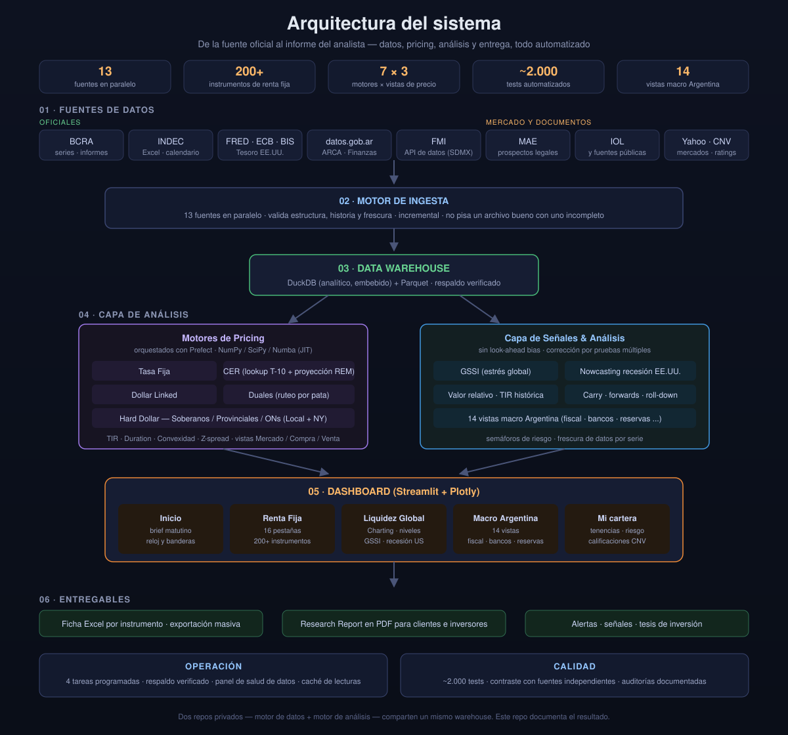
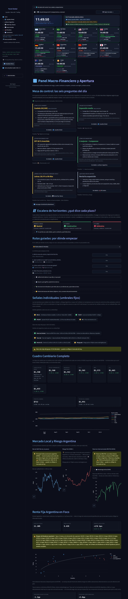
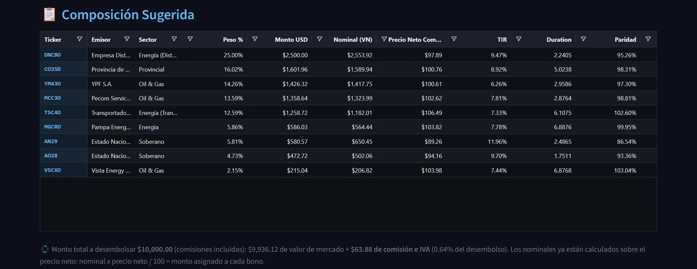
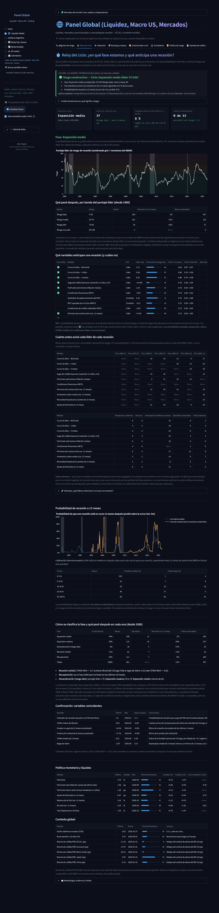
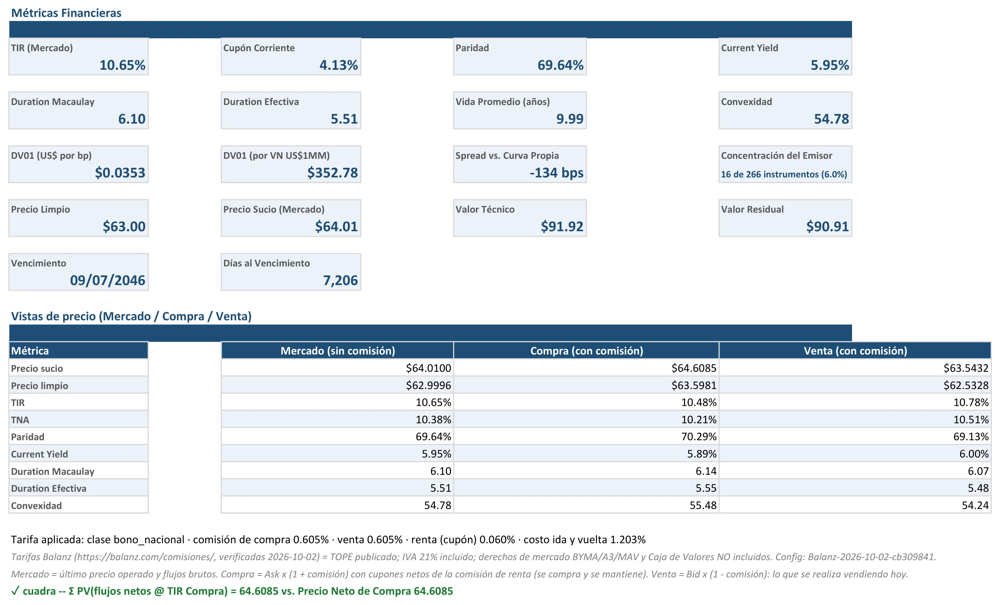
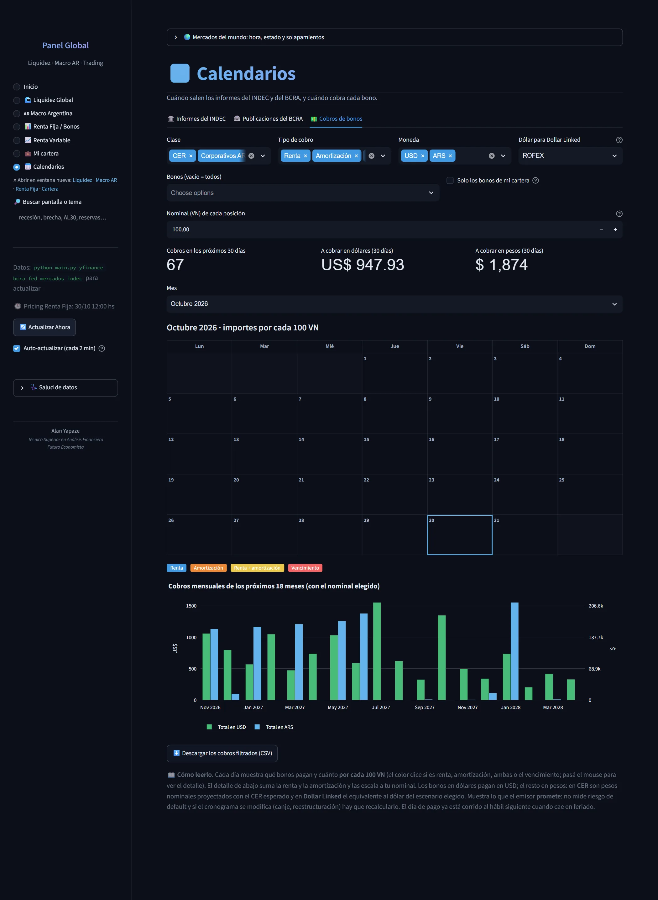

# Terminal de Renta Fija y Macroeconomía Argentina

**Una terminal de análisis propia para bonos argentinos, macroeconomía argentina, mercados globales y una cartera real: cada número se puede rastrear hasta su fuente y cada límite está declarado en pantalla.**

> 📌 **Este repositorio es una vidriera del proyecto.** Muestra el sistema funcionando, con capturas reales del 30/10/2026. El código fuente es privado.
>
> 🇬🇧 *English in five lines: a private, production-grade analyst terminal for Argentine fixed income and macro. 13 automated data sources, 200+ bonds priced with in-house engines in three price views (market / buy / sell, commissions included), 7 sections and ~153 screens (BCRA, INDEC, fiscal, banking, FX, global liquidity, recession clock, valuation, portfolio tools), Excel research sheets per instrument, and 2.704 automated tests plus an 11-round calculation audit. Negative results are published; statistical claims are corrected for multiple testing. Code is private; this repo documents it with real screenshots.*

**Autor:** Alan Yapaze — analista independiente · [LinkedIn](https://www.linkedin.com/in/alan-yapaze/)
**Vigencia:** 2023 – presente (iniciado como modelado manual en Excel, migrado en 2026 a una arquitectura Python automatizada)

## 🧭 Por dónde entrar

> Esta página es la portada. **Todo el detalle está en [`docs/`](docs/README.md)**: las 153 pantallas con su captura y la explicación de cada una, cómo calcula cada motor, los hallazgos con sus límites y la ingeniería detrás.

| Si querés... | Entrá a |
|---|---|
| **Ver las pantallas**, sección por sección | [Capturas por sección](docs/capturas/README.md) |
| Ver las **herramientas con parámetros** (Armador de portafolios, Breakeven, ficha de bono, Excel y PDF) | [Herramientas clave](docs/capturas/herramientas_clave.md) |
| Entender **cómo se calcula** (pricing, comisiones, vistas Mercado / Compra / Venta, Armador) | [Motores y herramientas](docs/motores.md) |
| Ver **una ficha Excel** por instrumento | [Exportación a Excel y PDF](docs/excel.md) |
| Saber **de dónde salen los datos** y cómo se actualizan | [Datos y pipeline](docs/datos_y_pipeline.md) |
| Leer **los análisis y sus límites**, incluidos los resultados negativos | [Hallazgos](docs/hallazgos.md) |
| Ver cómo se **controla la calidad** (tests, auditorías, errores corregidos) | [Ingeniería y calidad](docs/ingenieria.md) |
| Ver **qué se sumó** en octubre de 2026 y **qué sigue** | [Novedades](docs/novedades.md) · [Roadmap](docs/roadmap.md) |
| Ver el **README largo anterior**, módulo por módulo y con sus imágenes | [Versión anterior (15/10/2026)](https://github.com/YapazeAlan25/fixed-income-macro-terminal/blob/1a3eb0d/README.md) |

## Un vistazo

<table>
<tr><td width="50%" valign="top"> Inicio: banderas de riesgo, cuadro cambiario con brecha, contexto overnight y reloj de mercados</td><td width="50%" valign="top"> Armador de portafolios con Markowitz: composición con topes por emisor y sector, nominales y precio neto con comisiones</td></tr>
<tr><td width="50%" valign="top"> Reloj del ciclo de EE.UU.: puntaje líder, fase y evidencia con sus límites</td><td width="50%" valign="top"> Ficha Excel por instrumento: métricas y las tres vistas de precio con comisiones</td></tr>
<tr><td width="50%" valign="top"> Calendario de cobros de bonos: renta, amortización y vencimiento por mes y día</td><td></td></tr>
</table>

## Qué hay adentro

El escritorio tiene **7 secciones**. Cada una tiene su recorrido completo con capturas en [`docs/capturas/`](docs/capturas/README.md).

| Sección | Qué resuelve | Pantallas |
|---|---|---|
| [🏠 Inicio](docs/capturas/inicio.md) | El brief de la mañana: banderas de riesgo, cuadro cambiario con brecha, contexto overnight y el reloj de mercados del mundo. | 1 |
| [🌊 Liquidez Global](docs/capturas/liquidez.md) | El contexto global que mueve al mercado: régimen de riesgo, reloj del ciclo de EE.UU., valuación, burbujas, exposición, pronósticos, política de riesgo, spreads, liquidez y curvas. | 29 |
| [🇦🇷 Macro Argentina](docs/capturas/macro.md) | La economía real y financiera del país con datos oficiales: postura monetaria, cambiario, reservas, fiscal, monetario, crédito y bancos, actividad, precios, empleo, consumo, externo y expectativas. | 19 |
| [📊 Renta Fija / Bonos](docs/capturas/renta-fija.md) | Pricing de 7 tipos de instrumento en tres vistas de precio, curvas, valor relativo, arbitraje, carry trade, armador de portafolios y fichas por bono. | 24 |
| [📈 Renta Variable](docs/capturas/renta-variable.md) | Análisis fundamental de empresas a partir de los estados contables presentados ante la SEC. | 5 |
| [💼 Mi cartera](docs/capturas/cartera.md) | Diario de operaciones, tenencias con TIR del dinero, riesgo y estrés, calificaciones, swing en renta fija, fuerza relativa y rotación. | 15 |
| [📅 Calendarios](docs/capturas/calendarios.md) | Cuándo salen los informes del INDEC y del BCRA, y cuándo cobra cada bono. | 3 |

## El proyecto en números

| | |
|---|---|
| **13** | fuentes de descarga automática en paralelo (BCRA, INDEC, FRED, ECB, BIS, Tesoro de EE.UU., datos.gob.ar, ARCA, Secretaría de Finanzas, FMI, UTDT, mercados AR y yfinance), más precios de IOL, prospectos del MAE y calificaciones de la CNV |
| **200+** | instrumentos de renta fija cubiertos (36 soberanos/provinciales, 189 Obligaciones Negociables y letras y bonos en pesos) |
| **7** | tipos de instrumento con motor de pricing propio, cada uno en tres vistas de precio (Mercado, Compra y Venta, con comisiones del broker) |
| **7 / 153** | secciones del escritorio / pantallas documentadas con captura |
| **2.704** | tests automatizados (pricing, dashboard, descarga, cálculos macro y estadísticos, contrastes contra fuentes independientes) |
| **11** | oleadas de auditoría de cálculos, cada hallazgo con su test de regresión |
| **4** | tareas programadas (Windows Task Scheduler) que mantienen datos, precios, mercados e historia al día sin intervención manual |
| **~1m 40s** | descarga completa de las fuentes en paralelo |
| **21 s** | pipeline de pricing completo |

## Lo nuevo (octubre 2026)

- **Dos secciones nuevas:** 📈 Renta Variable (análisis de empresas por sus balances ante la SEC) y 📅 Calendarios (informes del INDEC y del BCRA, y cuándo cobra cada bono).
- **Macro Argentina:** postura monetaria, balance cambiario y corridas, riesgo local vs global, nowcast de actividad, precisión del REM, dinero e inflación, dólar a precios constantes, bancos por entidad y fondos comunes.
- **Liquidez Global:** régimen de riesgo, reloj del ciclo, valuación, burbujas, ¿posicionado o no?, pronósticos con registro de predicciones, política de riesgo y spreads de crédito.
- **Renta Fija:** escenarios y sensibilidad conjunta (riesgo país × tasa de EE.UU.), atribución de la TIR, precios dudosos, prima en pesos, confianza del dato y calificaciones de la CNV en las tablas.
- **Una auditoría de cálculos en 11 oleadas**, con cada hallazgo corregido y cubierto por un test.

Detalle en [`docs/novedades.md`](docs/novedades.md).

## Hallazgos que cambian cómo leer los datos

Cada análisis informa n, el estadístico, el azar esperable y, cuando se prueban muchas combinaciones, corrige por pruebas múltiples. **Los resultados negativos se publican.**

- **El «mejor rezago» engaña:** con series persistentes la regla ingenua lo da por significativo en 37 de 40 casos; calibrado contra el azar, en 1 de 40. Desde 2003 el adelanto entre dinero e inflación deja de distinguirse del azar.
- **Reloj del ciclo de EE.UU.:** la curva de tasas anticipa recesiones a 12 meses con AUC de 0,89 a 0,93; las coincidentes (empleo, producción) no anticipan. De 13 líderes, 10 resisten sacar cualquier recesión.
- **Argentina:** de 14 medidas probadas, solo las reservas brutas anticipan las contracciones del EMAE (corrección por pruebas múltiples incluida); el nowcast con datos tempranos no pasa la regla y se publica como negativo.
- **Los soberanos no siguen al Tesoro:** la tasa del Tesoro de igual duration explica ~1 % de la variación semanal de su TIR.
- **Ninguna señal técnica clásica sobrevive** a la corrección por pruebas múltiples (0 de 23 «significativas»).
- **Valuación:** un CAPE alto informa los próximos 5 a 10 años, no el momento.

Todos, con sus límites, en [`docs/hallazgos.md`](docs/hallazgos.md).

## Cómo se construye con rigor

- **2.704 tests automatizados** que cubren pricing, dashboard, descarga, cálculos macro y estadísticos y contrastes contra fuentes independientes; la tarea programada corre exactamente el mismo pipeline que una corrida manual.
- **Auditoría de cálculos en 11 oleadas**: se recalcula a mano con datos reales, se corrige con un test de regresión y se documenta. Hallazgos como una regla estadística que daba falsos positivos en 37 de 40 casos o una TIR de cartera que se hundía de 10,1 % a −7,6 % por un bono sin cronograma.
- **Cada límite está declarado en pantalla**: el sistema prefiere mostrar «sin dato» a una cifra fabricada, marca lo calculado «en la muestra» y publica lo que no funciona.
- **Datos con control propio**: frescura de 23 módulos del INDEC contra su calendario real, respaldo semanal con manifiesto SHA-256 y panel de salud de datos.

Más en [`docs/ingenieria.md`](docs/ingenieria.md).

## Documentación

| Página | Qué encontrás |
|---|---|
| [Capturas por sección](docs/capturas/README.md) | Las 153 pantallas del terminal, con la explicación que trae cada una |
| [Novedades](docs/novedades.md) | Qué se sumó desde la versión anterior de esta vidriera |
| [Motores y herramientas](docs/motores.md) | Pricing, comisiones y vistas Mercado / Compra / Venta, Armador de portafolios, terminal de analista, fiscal y bancos, Mi cartera |
| [Exportación a Excel y PDF](docs/excel.md) | Fichas por instrumento con el valor presente de cada flujo, archivos «Global» y Research Report |
| [Datos y pipeline](docs/datos_y_pipeline.md) | Arquitectura, cobertura de datos, ejecución diaria |
| [Hallazgos](docs/hallazgos.md) | Análisis con sus límites y resultados negativos |
| [Ingeniería y calidad](docs/ingenieria.md) | Auditorías, errores encontrados y corregidos, stack técnico |
| [Roadmap](docs/roadmap.md) | Lo que sigue |

## Stack técnico (resumen)

Python 3.11 · Streamlit y Plotly · DuckDB y Parquet · Prefect · NumPy, SciPy y Numba · openpyxl · pytest · GitHub Actions · Windows Task Scheduler. Detalle en [Ingeniería y calidad](docs/ingenieria.md#stack-técnico).

**Cómo trabajo con IA:** la lógica financiera, las decisiones de diseño y la verificación son propias; la implementación de código se desarrolló con asistentes de IA (Claude, Gemini). El valor está en dirigirlos con criterio y en el proceso de verificación (tests, contrastes y auditorías) que impide aceptar un resultado sin comprobarlo.

## Aviso legal

Este repositorio es **informativo y educativo**. No constituye asesoramiento ni recomendación de inversión, ni una oferta de compra o venta de ningún instrumento. Los datos provienen de fuentes públicas oficiales y de mercado, se muestran con su fecha y pueden tener demoras o errores. Las capturas incluyen una cartera real del autor como ejemplo de uso de la herramienta, no como sugerencia. Rendimientos pasados no garantizan rendimientos futuros.

© Alan Yapaze. Textos, diagramas e imágenes: todos los derechos reservados. El código es privado.

## Contacto

¿Preguntas sobre el proyecto o interés en el desarrollo? [Alan Yapaze en LinkedIn](https://www.linkedin.com/in/alan-yapaze/)
