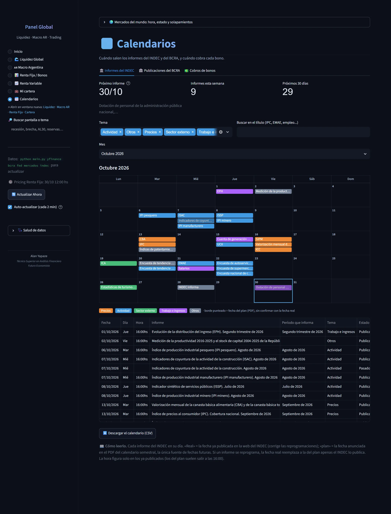
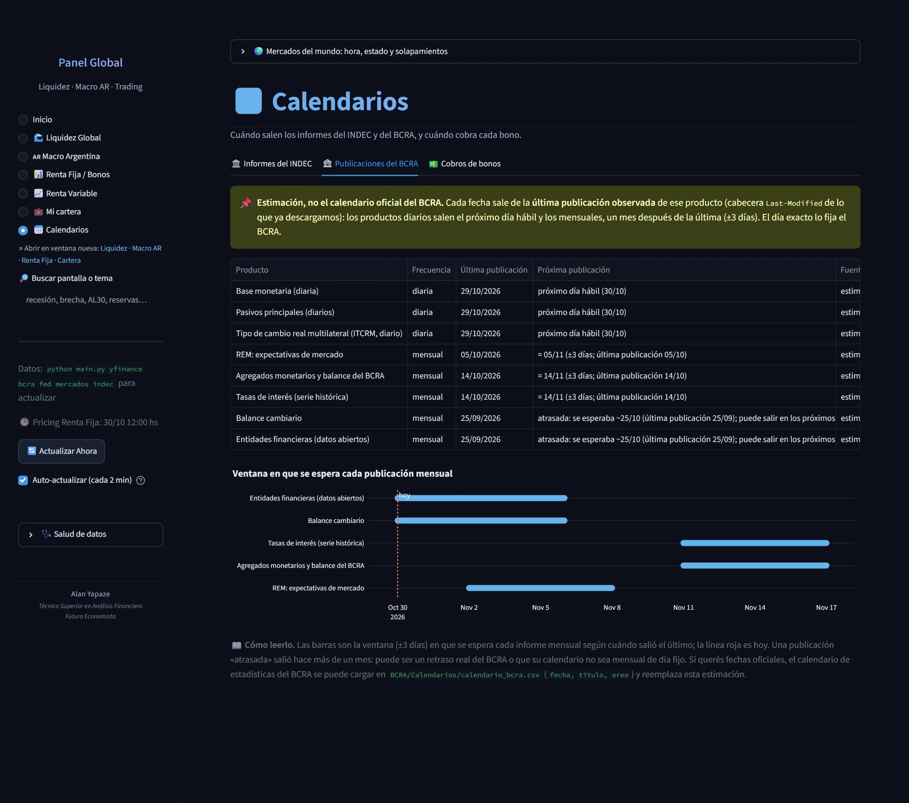
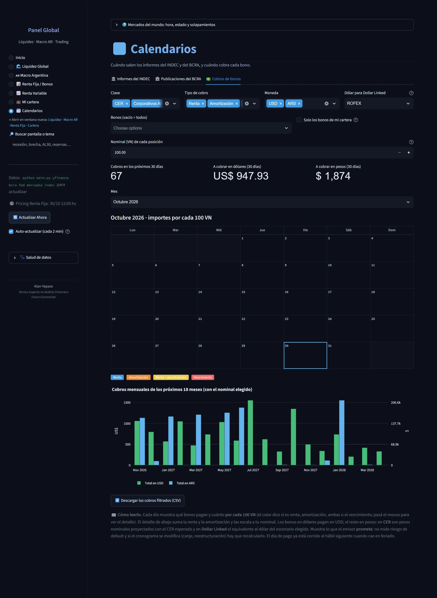

# 📅 Calendarios

Cuándo salen los informes del INDEC y del BCRA, y cuándo cobra cada bono.

**3 pantallas.** [Volver al índice](README.md) · [Inicio del repositorio](../../README.md)

## Informes del INDEC

> Dotación de personal de la administración pública nacional,… 📖 Cómo leerlo. Cada informe del INDEC en su día. «Real» = la fecha ya publicada en la web del INDEC (corrige las reprogramaciones); «plan» = la fecha anunciada en el PDF del calendario semestral, la única fuente de fechas futuras. Si un informe se reprograma, la fecha real reemplaza a la del plan apenas el INDEC lo publica. La hora figura solo en los ya publicados (los del plan suelen salir a las 16:00).

## Publicaciones del BCRA

> 📖 Cómo leerlo. Las barras son la ventana (±3 días) en que se espera cada informe mensual según cuándo salió el último; la línea roja es hoy. Una publicación «atrasada» salió hace más de un mes: puede ser un retraso real del BCRA o que su calendario no sea mensual de día fijo. Si querés fechas oficiales, el calendario de estadísticas del BCRA se puede cargar en BCRA/Calendarios/calendario_bcra.csv (fecha, titulo, are 📌  Estimación, no el calendario oficial del BCRA. Cada fecha sale de la última publicación observada de ese producto (cabecera Last-Modified de lo que ya descargamos): los productos diarios salen el próximo día hábil y los mensuales, un mes después de la última (±3 días). El día exacto lo fija el BCRA.

## Cobros de bonos

> 📖 Cómo leerlo. Cada día muestra qué bonos pagan y cuánto por cada 100 VN (el color dice si es renta, amortización, ambas o el vencimiento; pasá el mouse para ver el detalle). El detalle de abajo suma la renta y la amortización y las escala a tu nominal. Los bonos en dólares pagan en USD; el resto en pesos: en CER son pesos nominales proyectados con el CER esperado y en Dollar Linked el equivalente al dólar del escen
