# 💼 Mi cartera

Diario de operaciones, tenencias con TIR del dinero, riesgo y estrés, calificaciones, swing en renta fija, fuerza relativa y rotación.

**15 pantallas.** [Volver al índice](README.md) · [Inicio del repositorio](../../README.md)

> ℹ️ **Sobre estas capturas:** muestran una herramienta de análisis con datos de mercado del día. Los tickers, rendimientos y señales que aparecen son resultados del cálculo para ilustrar su funcionamiento: **no son recomendaciones de inversión** ni ofertas de compra o venta.

## Diario de operaciones

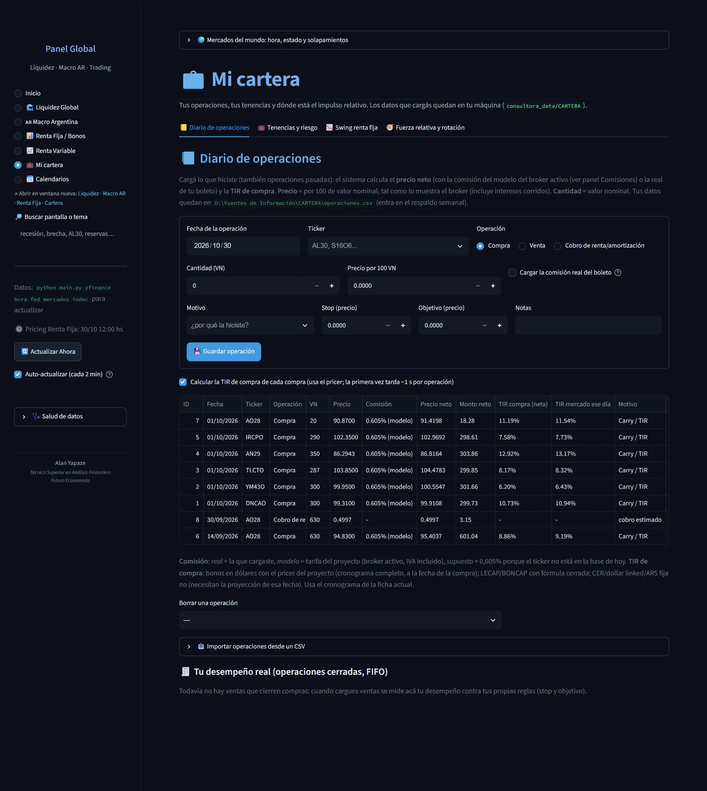

> Cargá lo que hiciste (también operaciones pasadas): el sistema calcula el precio neto (con la comisión del modelo del broker activo (ver panel Comisiones) o la real de tu boleto) y la TIR de compra. Precio = por 100 de valor nominal, tal como lo muestra el broker (incluye intereses corridos). Cantidad = valor nominal. Comisión: real = la que cargaste, modelo = tarifa del proyecto (broker activo, IVA incluido), supuesto = 0,605% porque el ticker no está en la base de hoy. TIR de compra: bonos en dólares con el pricer del proyecto (cronograma completo, a la fecha de la compra); LECAP/BONCAP con fórmula cerrada; CER/dollar linked/ARS fija no (necesitan la proyección de esa fecha). Usa el cronograma de la ficha actual.

## Tenencias y riesgo

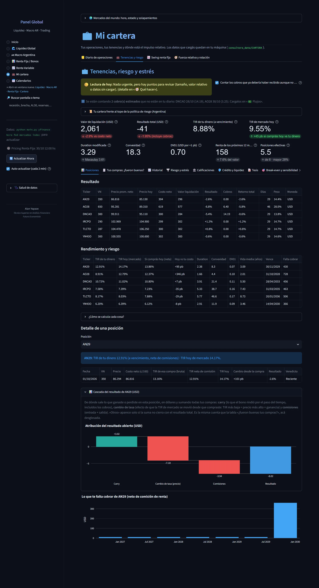

> De dónde sale lo que ganaste o perdiste en esta posición, en dólares y sumando todas tus compras: carry (lo que el bono rindió por el paso del tiempo, incluidos los cobros), cambio de tasa (efecto de que la TIR de mercado se movió desde que compraste: TIR más baja = precio más alto = ganancia) y comisiones (entrada + salida). «Otros» aparece solo si la suma no cierra con el resultado total.

## Tenencias y riesgo › Tus compras: ¿fueron buenas?

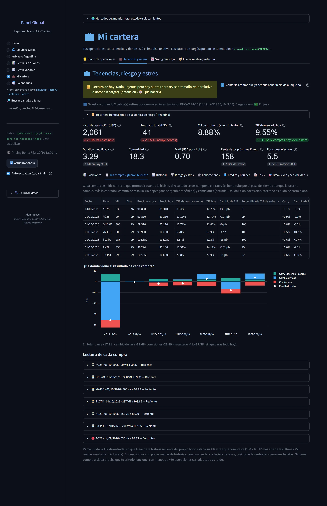

> Cada compra se mide contra lo que prometía cuando la hiciste. El resultado se descompone en: carry (el bono sube por el paso del tiempo aunque la tasa no cambie, más lo cobrado), cambio de tasa (la TIR bajó = ganancia; subió = pérdida) y comisiones (entrada + salida). Con pocos días, casi todo es ruido de corto plazo.

## Tenencias y riesgo › Historial

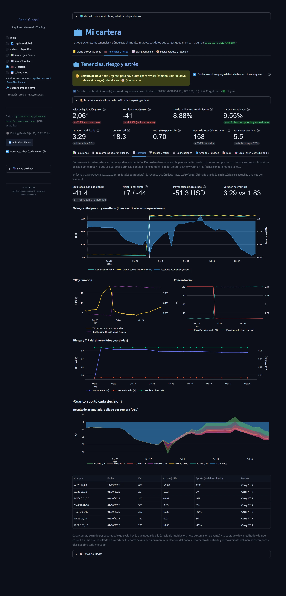

> Cómo evolucionó tu cartera y cuánto aportó cada decisión. Reconstruido = se recalcula para cada día desde tu primera compra con tu diario y los precios históricos de cada bono; foto = lo que se guardó al abrir esta pantalla (tiene también TIR del dinero, desvío y VaR). En las fechas con foto manda la foto.

## Tenencias y riesgo › Riesgo y estrés

*Pantalla larga: se muestra en 2 partes, de arriba hacia abajo.*

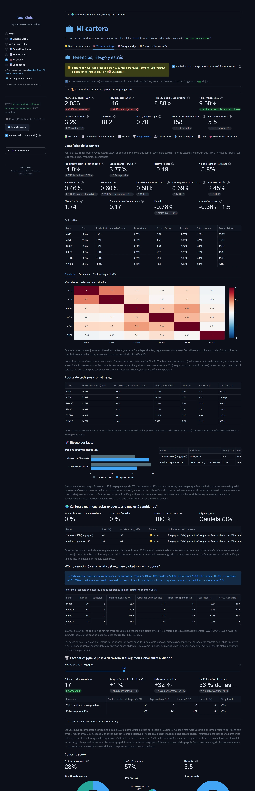

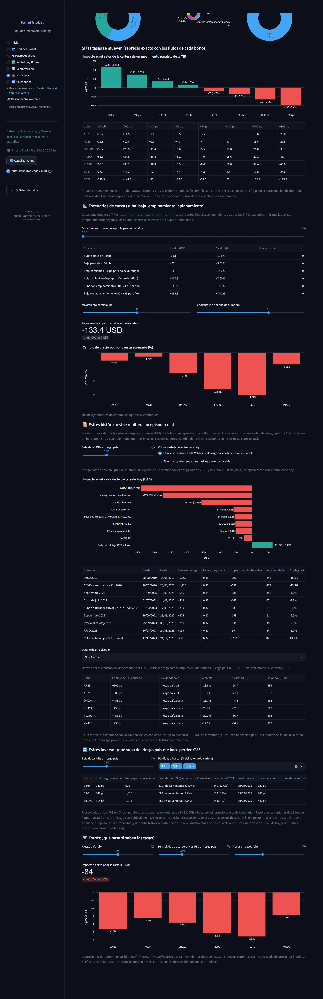

> Ventana: 121 ruedas (29/04/2026 a 22/10/2026) en común de 6 bonos, que cubren 100% de la cartera. Retorno total diario aproximado (carry + efecto de la tasa), con los pesos de hoy mantenidos constantes.

## Tenencias y riesgo › Calificaciones

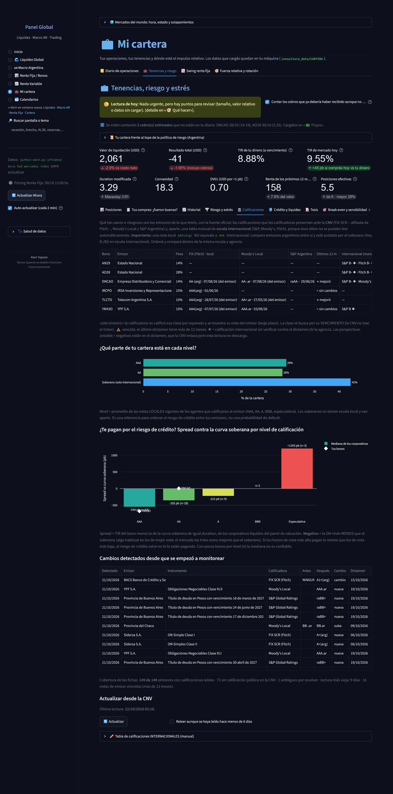

> Qué tan sanos o riesgosos son los emisores de lo que tenés, con la fuente oficial: las calificaciones que las calificadoras presentan ante la CNV (FIX SCR —afiliada de Fitch—, Moody's Local y S&P Argentina) y, aparte, una tabla manual de escala internacional (S&P, Moody's, Fitch), porque esos sitios no se pueden leer automáticamente.

## Tenencias y riesgo › Crédito y liquidez

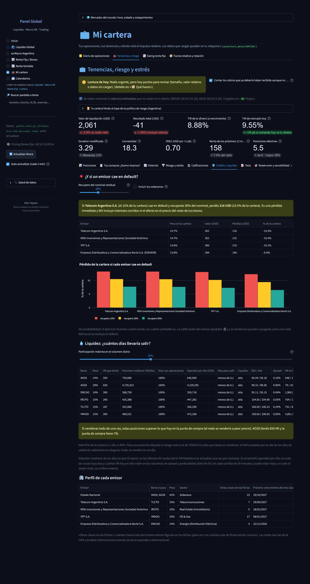

> Sin probabilidad: el ejercicio muestra cuánto duele, no cuánto probable es. La calificación del emisor (pestaña 🏛️) y su tendencia ayudan a juzgarlo, pero una nota AAA local no excluye el default.

## Tenencias y riesgo › Break-even y sensibilidad

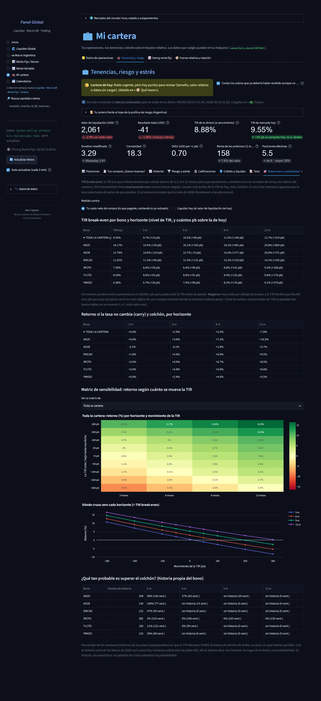

> TIR break-even: la TIR a la que el bono tendría que cotizar dentro de 3, 6, 9 o 12 meses para que mantenerlo y venderlo (con la comisión de venta, los cobros del camino y SIN reinvertirlos) rinda exactamente cero contra la base elegida. Cuanto más arriba de la TIR de hoy, más colchón: el carry (los intereses) aguanta que la tasa suba hasta ahí antes de que pierdas.

## Tenencias y riesgo › Simulador

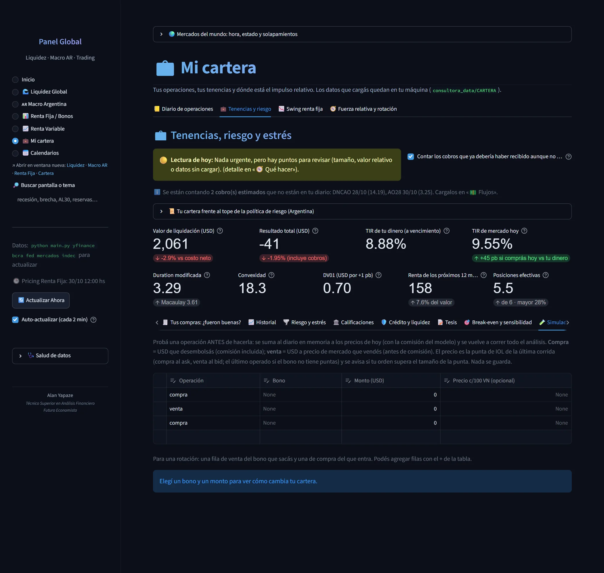

> Probá una operación ANTES de hacerla: se suma al diario en memoria a los precios de hoy (con la comisión del modelo) y se vuelve a correr todo el análisis. Compra = USD que desembolsás (comisión incluida); venta = USD a precio de mercado que vendés (antes de comisión).

## Tenencias y riesgo › Flujos y reinversión

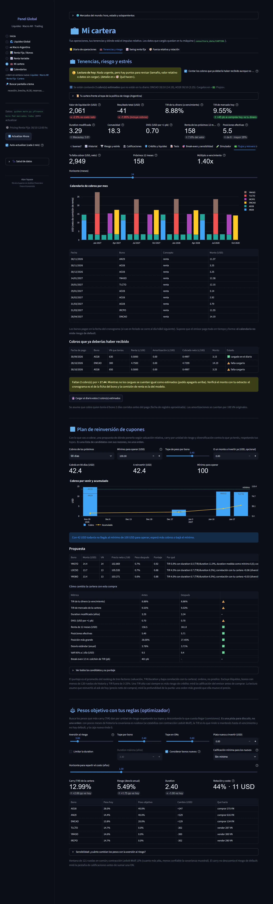

> Los bonos pagan en la fecha del cronograma (si cae en feriado se corre al día hábil siguiente). Supone que el emisor paga todo en tiempo y forma: el calendario no mide riesgo de default.

## Swing renta fija

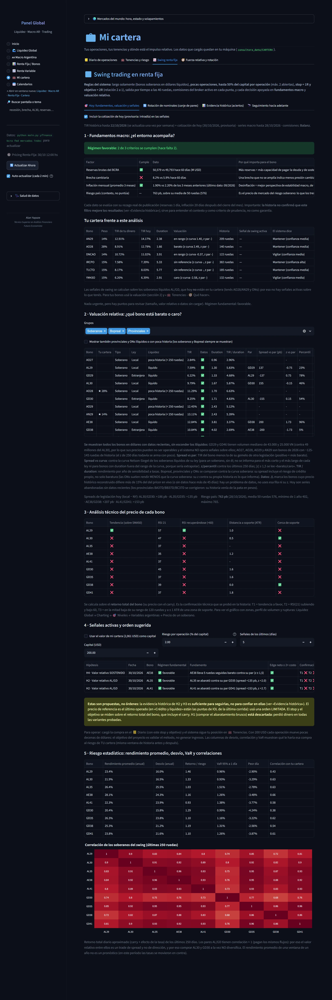

> TIR histórica hasta 22/10/2026 (se actualiza una vez por semana) + cotización de hoy (30/10/2026, provisoria) · series macro hasta 28/10/2026 · comisiones: Balanz. Cada dato se evalúa con su rezago real de publicación (reservas 1 día, inflación 20 días después del cierre del mes). Importante: la historia no confirmó que este filtro mejore los resultados (ver «Evidencia histórica»); sirve para entender el contexto y como criterio de prudencia, no como garantía.

## Swing renta fija › Rotación de nominales (canje de pares)

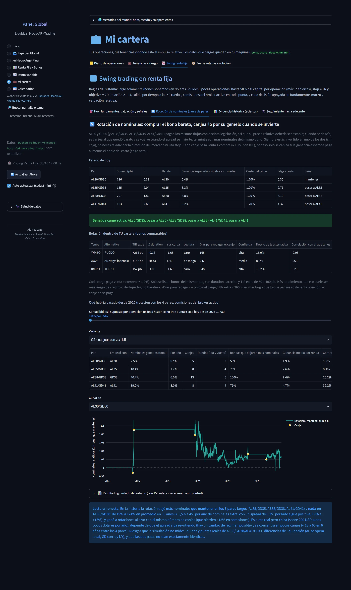

> AL30 y GD30 (y AL35/GD35, AE38/GD38, AL41/GD41) pagan los mismos flujos con distinta legislación, así que su precio relativo debería ser estable; cuando se desvía, se canjea al que quedó barato y se vuelve cuando el spread se invierte: terminás con más nominales del mismo bono. Siempre estás invertido en uno de los dos (sin caja), no necesita adivinar la dirección del mercado ni usa stop. Cada canje paga venta + compra (≈ 1,2%). Solo se listan bonos del mismo tipo, con duration parecida y TIR extra de 50 a 400 pb. Más rendimiento que eso suele ser más riesgo de crédito o de iliquidez, no baratura. «Días para repagar» = costo del canje / TIR extra x 365: si es más largo que lo que pensás sostener la posición, el canje no se paga.

## Swing renta fija › Evidencia histórica (aciertos)

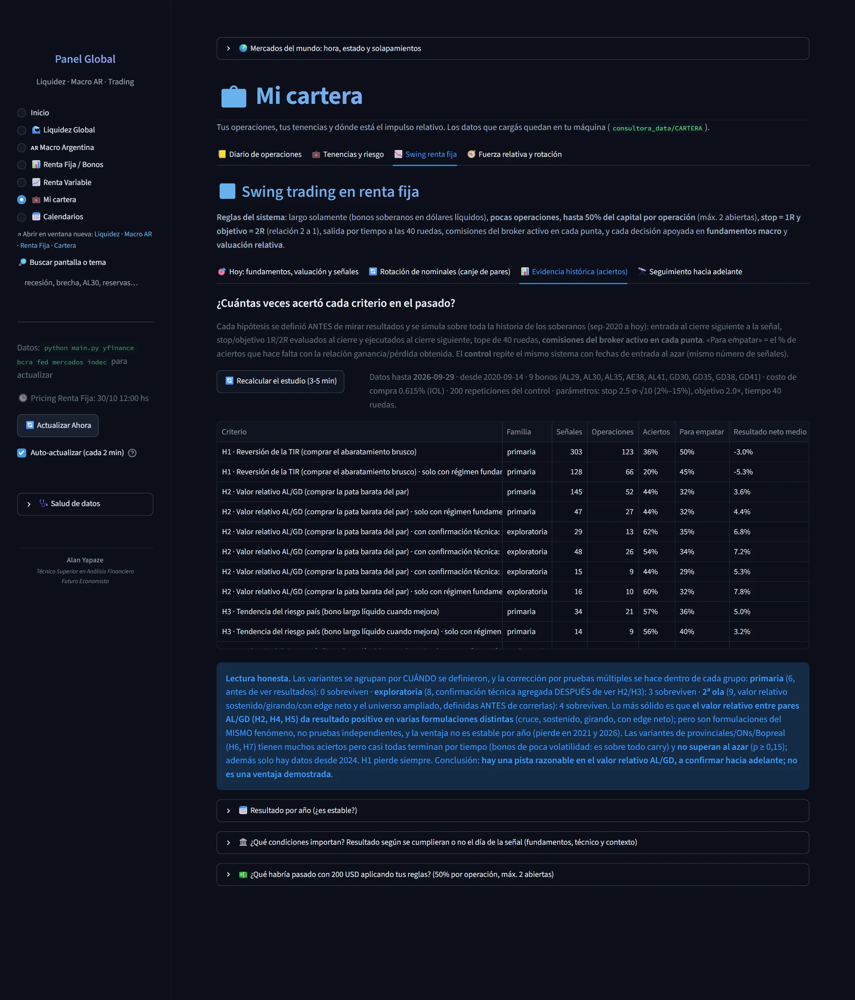

> Cada hipótesis se definió ANTES de mirar resultados y se simula sobre toda la historia de los soberanos (sep-2020 a hoy): entrada al cierre siguiente a la señal, stop/objetivo 1R/2R evaluados al cierre y ejecutados al cierre siguiente, tope de 40 ruedas, comisiones del broker activo en cada punta. «Para empatar» = el % de aciertos que hace falta con la relación ganancia/pérdida obtenida. Datos hasta 2026-09-29 · desde 2020-09-14 · 9 bonos (AL29, AL30, AL35, AE38, AL41, GD30, GD35, GD38, GD41) · costo de compra 0.615% (IOL) · 200 repeticiones del control · parámetros: stop 2.5·σ·√10 (2%–15%), objetivo 2.0×, tiempo 40 ruedas.

## Swing renta fija › Seguimiento hacia adelante

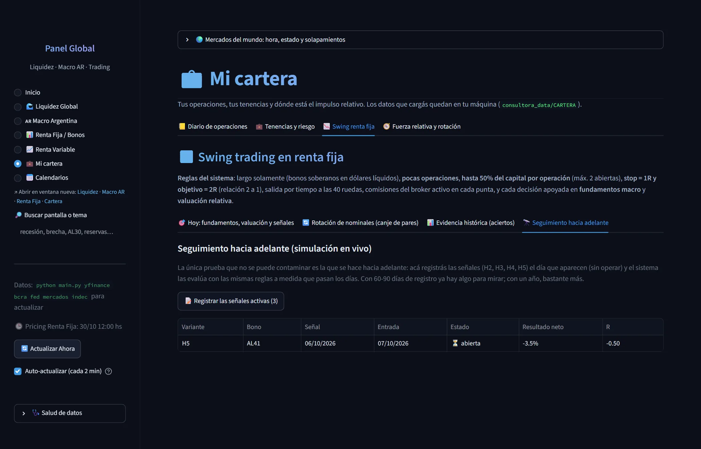

> La única prueba que no se puede contaminar es la que se hace hacia adelante: acá registrás las señales (H2, H3, H4, H5) el día que aparecen (sin operar) y el sistema las evalúa con las mismas reglas a medida que pasan los días. Con 60-90 días de registro ya hay algo para mirar; con un año, bastante más.

## Fuerza relativa y rotación

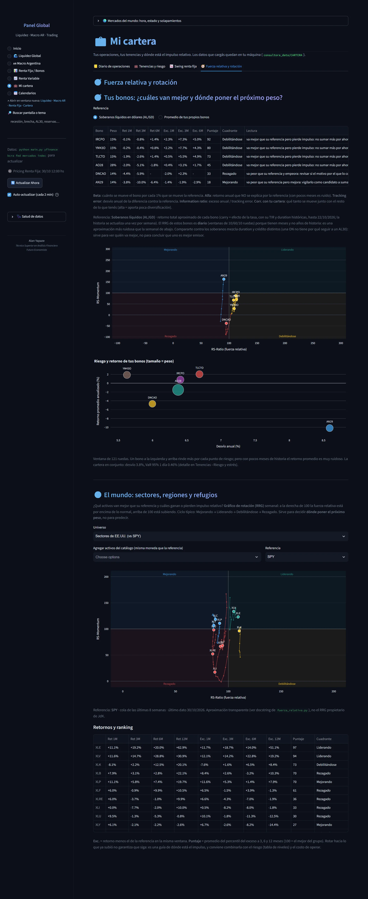

> Beta: cuánto se mueve el bono por cada 1% que se mueve la referencia. Alfa: retorno anual que NO se explica por la referencia (con pocos meses es ruido). Tracking error: desvío anual de la diferencia contra la referencia. Information ratio: exceso anual / tracking error. Corr. con tu cartera: qué tanto se mueve junto con el resto de lo que tenés (alta = aporta poca diversificación). Referencia: Soberanos líquidos (AL/GD) · retorno total aproximado de cada bono (carry + efecto de la tasa, con su TIR y duration históricas, hasta 22/10/2026; la historia se actualiza una vez por semana). El RRG de estos bonos es diario (ventanas de 10/60/10 ruedas) porque tienen meses y no años de historia: es una aproximación más ruidosa que la semanal de abajo.
