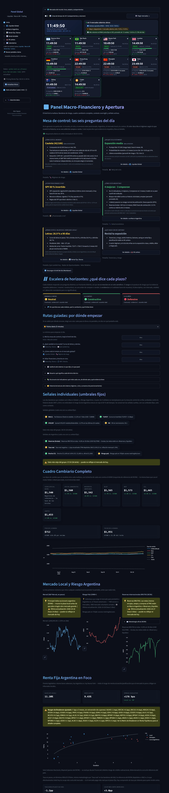
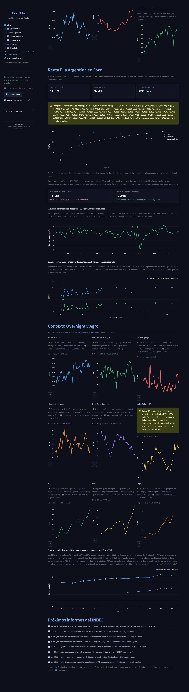

# 🏠 Inicio

El brief de la mañana: banderas de riesgo, cuadro cambiario con brecha, contexto overnight y el reloj de mercados del mundo.

**1 pantalla.** [Volver al índice](README.md) · [Inicio del repositorio](../../README.md)

> ℹ️ **Sobre estas capturas:** muestran una herramienta de análisis con datos de mercado del día. Los tickers, rendimientos y señales que aparecen son resultados del cálculo para ilustrar su funcionamiento: **no son recomendaciones de inversión** ni ofertas de compra o venta.

## 🏠 Inicio

*Pantalla larga: se muestra en 2 partes, de arriba hacia abajo.*

> De lo general a lo particular: el mundo, el ciclo, si conviene estar posicionado, Argentina, el mercado local y tu cartera. El color describe el régimen según lo que mostró la historia; no es una señal de compra o venta. Cada tarjeta dice qué evidencia la respalda y lleva al detalle. 🟢 Maquinaria diaria en orden (revisada el 30/10 10:42).
