# 🌊 Liquidez Global

El contexto global que mueve al mercado: régimen de riesgo, reloj del ciclo de EE.UU., valuación, burbujas, exposición, pronósticos, política de riesgo, spreads, liquidez y curvas.

**28 pantallas.** [Volver al índice](README.md) · [Inicio del repositorio](../../README.md)

## Régimen de riesgo

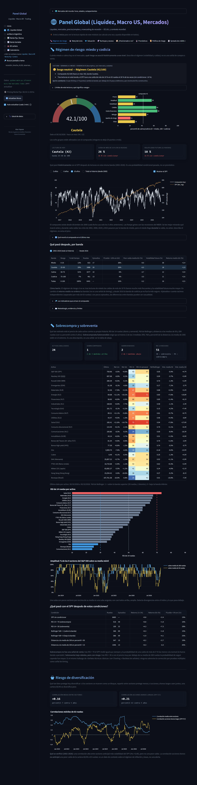

> Cuánto miedo o calma hay en el mercado y qué riesgo se asoció históricamente a ese nivel. Describe el régimen (volatilidad y caídas); no es una señal de compra o venta. Los ocho grupos están alineados con el compuesto (ninguno se aleja 25 puntos o más).

## Reloj del ciclo

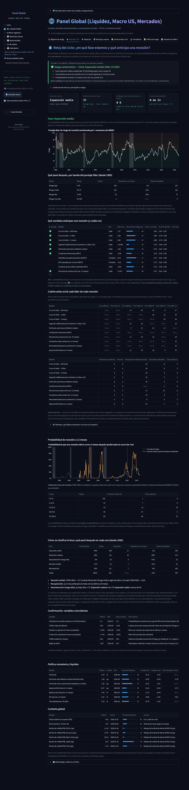

> Qué variables anticiparon las 8 recesiones de EE.UU. desde 1969, en qué fase del ciclo está hoy la economía y con qué probabilidad. Describe y ordena el riesgo; no es un pronóstico: son pocas recesiones y los datos son los finales, no los que se conocían en tiempo real. La probabilidad sale de un probit sobre la curva de tasas (Estrella-Mishkin); con la curva 10a−fed funds (más historia): 6 %. Fuera de muestra sobrestima los niveles altos (ver calibración abajo): usala para ordenar, no como cifra exacta.

## Valuación

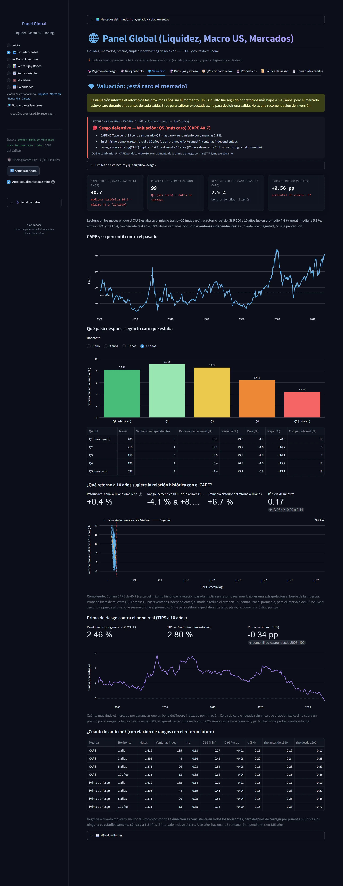

> Cómo leerlo. Con un CAPE de 40.7 (cerca del máximo histórico) la relación pasada implica un retorno real muy bajo; es una extrapolación al borde de la muestra. Probada fuera de muestra (1,042 meses, unas 9 ventanas independientes) el modelo redujo el error en 9 % contra usar el promedio, pero el intervalo del R² incluye el cero: no se puede afirmar que sea mejor que el promedio. Sirve para calibrar expectativas de la Cuánto más rinde el mercado por ganancias que un bono del Tesoro indexado por inflación. Cerca de cero o negativa significa que el accionista casi no cobra un premio por el riesgo. Solo hay datos desde 2003, así que el percentil se mide contra 20 años y un ciclo de tasas muy particular; no se probó cuánto anticipa.

## Burbujas y exceso

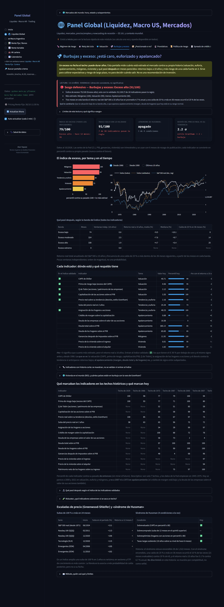

> Datos al 10/2026. Las series de la Fed (Z.1, PIB, ganancias, vivienda) son trimestrales y se usan con 6 meses de rezago de publicación; cada indicador se convierte en percentil contra su propio pasado (nunca contra el futuro). Retorno real total anualizado del S&P 500 a 10 años y frecuencia de una caída de 25 % o más dentro de los 36 meses siguientes, a partir de los meses en cada banda. Pocas ventanas independientes: orden de magnitud, no una probabilidad.

## ¿Posicionado o no?

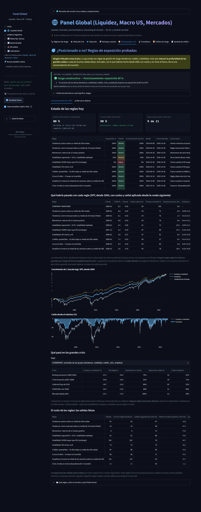

> Los intervalos (95 %, bootstrap de bloques de 63 ruedas sobre los retornos diarios) incluyen al cero casi siempre en el Sharpe: ninguna regla mejoró el retorno ajustado por riesgo de forma estadísticamente clara. La ganancia consistente está en la caída máxima: las reglas de tendencia, crédito y el consenso recortaron lo peor de los grandes mercados bajistas sin dejar de rendir parecido. «Exposición en el pico» es lo que la regla tenía puesto el día que el mercado hizo su máximo: ninguna regla avisó antes del pico; reducen la exposición a medida que la caída avanza. «Caída evitada» = parte de la pérdida de comprar y mantener que la regla no sufrió.

## ¿Posicionado o no? › Merval en dólares

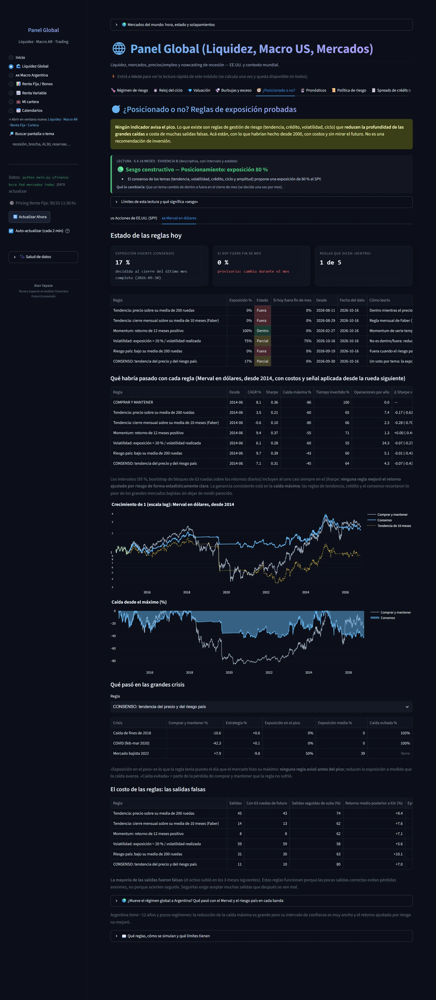

> Los intervalos (95 %, bootstrap de bloques de 63 ruedas sobre los retornos diarios) incluyen al cero casi siempre en el Sharpe: ninguna regla mejoró el retorno ajustado por riesgo de forma estadísticamente clara. La ganancia consistente está en la caída máxima: las reglas de tendencia, crédito y el consenso recortaron lo peor de los grandes mercados bajistas sin dejar de rendir parecido. «Exposición en el pico» es lo que la regla tenía puesto el día que el mercado hizo su máximo: ninguna regla avisó antes del pico; reducen la exposición a medida que la caída avanza. «Caída evitada» = parte de la pérdida de comprar y mantener que la regla no sufrió.

## Pronósticos

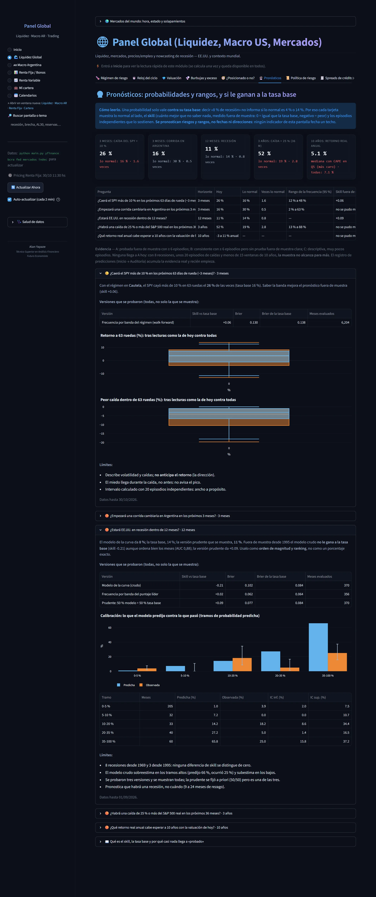

> Evidencia — A: probada fuera de muestra con ≥ 6 episodios; B: consistente con ≥ 6 episodios pero sin prueba fuera de muestra clara; C: descriptiva, muy pocos episodios. Ninguna llega a A hoy: con 8 recesiones, unos 20 episodios de caídas y menos de 15 ventanas de 10 años, la muestra no alcanza para más. El registro de predicciones (Inicio → Auditoría) acumula la evidencia real y recién empieza. Cómo leerlo. Una probabilidad solo vale contra su tasa base: decir «8 % de recesión» no informa si lo normal es 4 % o 14 %. Por eso cada tarjeta muestra lo normal al lado, el skill (cuánto mejor que no saber nada, medido fuera de muestra: 0 = igual que la tasa base, negativo = peor) y los episodios independientes que lo sostienen. Se pronostican riesgos y rangos, no fechas ni direcciones: ningún indicador de esta pan

## Política de riesgo

> Una política fija antes de que pase algo cuánto riesgo estás dispuesto a tener según lo que digan los módulos: así, en el momento de estrés, la decisión ya está tomada. No dice qué comprar ni vender: da un tope del presupuesto de riesgo (% del máximo que decidiste tolerar). Las reglas de abajo son un ejemplo razonable, con los cortes de banda de cada módulo; revisalas, editalas y confirmalas.

## Spreads de crédito

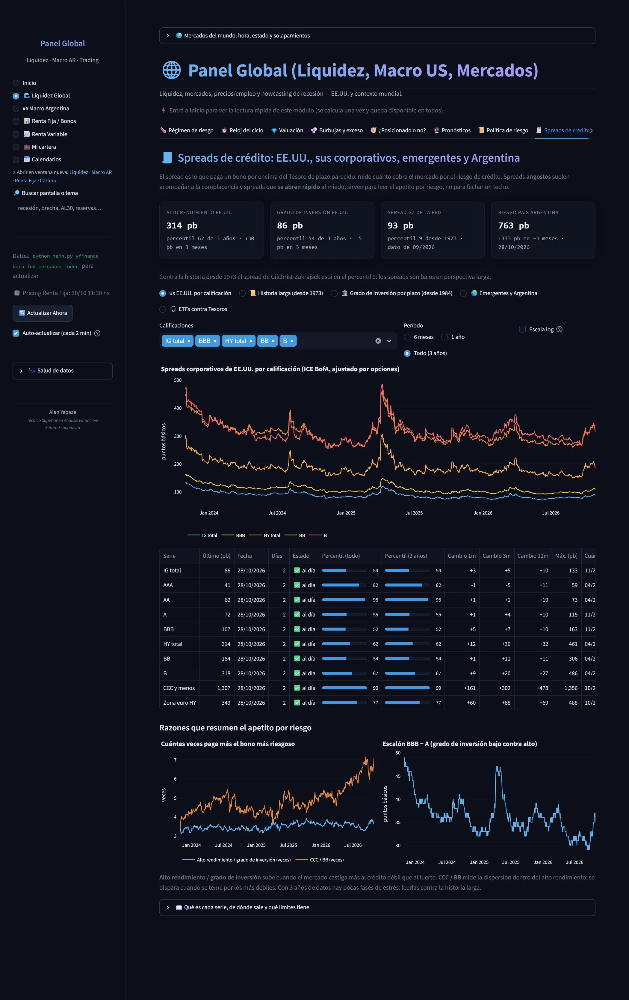

> El spread es lo que paga un bono por encima del Tesoro de plazo parecido: mide cuánto cobra el mercado por el riesgo de crédito. Spreads angostos suelen acompañar a la complacencia y spreads que se abren rápido al miedo; sirven para leer el apetito por riesgo, no para fechar un techo. Contra la historia desde 1973 el spread de Gilchrist-Zakrajšek está en el percentil 9: los spreads son bajos en perspectiva larga.

## Explorador de series

> Buscá cualquiera de las series de la FED, del BCRA, del BIS, del BCE y del Tesoro, graficala con una transformación y compará varias. Lo que ves acá no está validado: ninguna de estas series es un indicador del sistema hasta que pase por el marco de robustez («Reloj del ciclo» y «Burbujas» muestran cuáles sí). Sirve para explorar y para encontrar candidatas. 300 serie(s) coinciden (se muestran hasta 300: afiná la búsqueda) · 3,019 en el catálogo · 2,653 sin uso en ninguna pantalla.

## Liquidez y Tasas

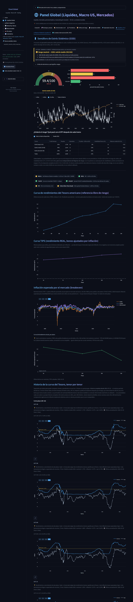

> Promedio del percentil contra los 5 años previos de cuatro medidas de estrés: VIX, MOVE (bonos), VVIX (volatilidad del VIX) y CISS (estrés sistémico del BCE). 0 = el estrés más bajo de los 5 años, 100 = el más alto. Cómo leerlo. Las probabilidades salen de lo que ocurrió después de cada tramo (desde 2004); no son pronósticos. El GSSI ordena bien el riesgo de caída y de volatilidad (AUC 0.77, IC 95 % 0.66-0.86), pero no es independiente del Régimen de riesgo: es en la práctica su subconjunto de volatilidad y estrés (correlación de rangos 0.74; el compuesto completo da AUC 0.76, IC 0.69-0.82). El retorno medio posterior no ordena 

## Liquidez y Tasas › Contexto Internacional (BIS / BCE)

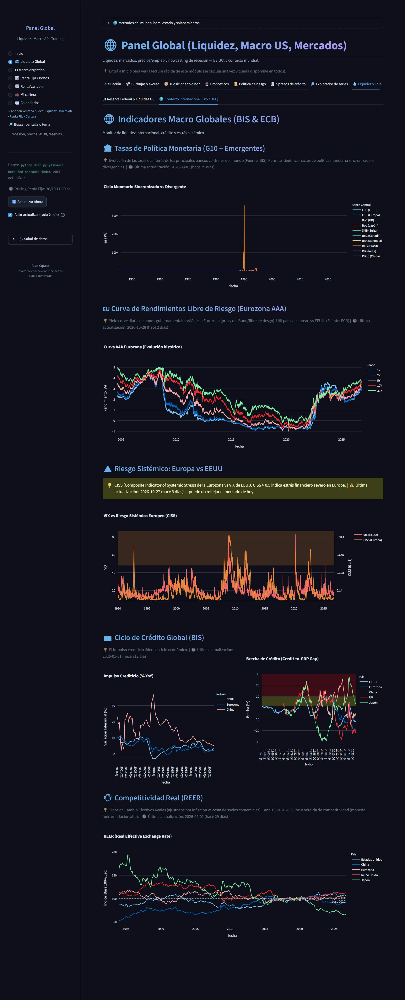

> 💡 Evolución de las tasas de interés de los principales bancos centrales del mundo (Fuente: BIS). Permite identificar ciclos de política monetaria sincronizada o divergencias. | 🕒 Última actualización: 2026-09-01 (hace 29 días) 💡 Yield curve diaria de bonos gubernamentales AAA de la Eurozona (proxy del Bund/libre de riesgo). Útil para ver spread vs EEUU. (Fuente: ECB) | 🕒 Última actualización: 2026-10-28 (hace 2 días)

## Mercados

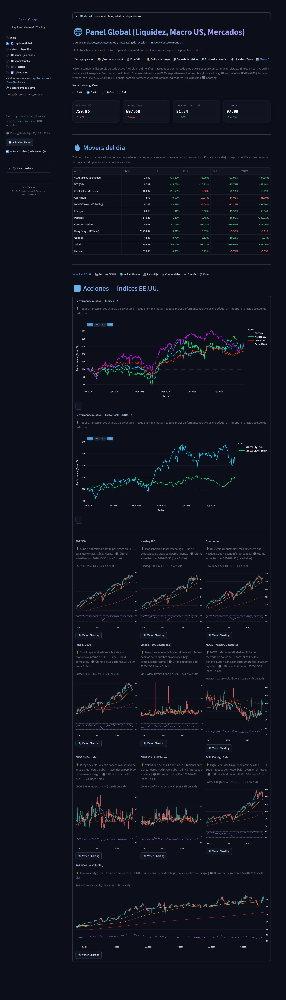

> Historia completa disponible de cada activo (no solo el último año) — agrupados por mercado para que se puedan comparar de un vistazo. El texto en cursiva arriba de cada gráfico explica cómo leer el movimiento. Donde el dato existe en FRED, se prefiere esa fuente sobre yfinance. Los gráficos son velas SEMANALES (cierre de viernes) con SMA 20/50/200 y RSI 21 debajo; para diario/mensual/intradía y más indicadores usá l Todo el universo de mercados ordenado por variación de hoy — para escanear qué se movió sin recorrer los ~40 gráficos de abajo uno por uno. Clic en una columna del encabezado para reordenar por esa variación.

## Mercados › Sectores EE.UU.

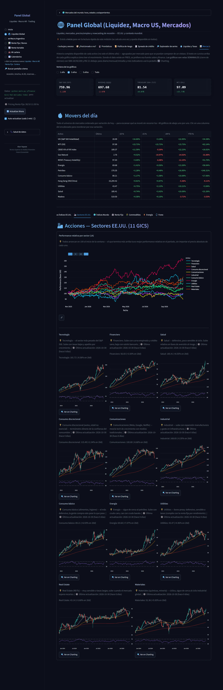

> Historia completa disponible de cada activo (no solo el último año) — agrupados por mercado para que se puedan comparar de un vistazo. El texto en cursiva arriba de cada gráfico explica cómo leer el movimiento. Donde el dato existe en FRED, se prefiere esa fuente sobre yfinance. Los gráficos son velas SEMANALES (cierre de viernes) con SMA 20/50/200 y RSI 21 debajo; para diario/mensual/intradía y más indicadores usá l Todo el universo de mercados ordenado por variación de hoy — para escanear qué se movió sin recorrer los ~40 gráficos de abajo uno por uno. Clic en una columna del encabezado para reordenar por esa variación.

## Mercados › Índices Mundo

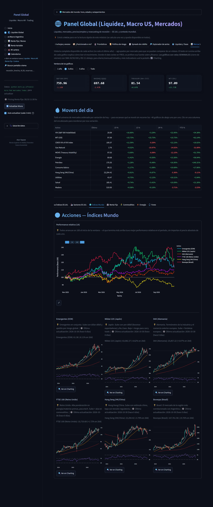

> Historia completa disponible de cada activo (no solo el último año) — agrupados por mercado para que se puedan comparar de un vistazo. El texto en cursiva arriba de cada gráfico explica cómo leer el movimiento. Donde el dato existe en FRED, se prefiere esa fuente sobre yfinance. Los gráficos son velas SEMANALES (cierre de viernes) con SMA 20/50/200 y RSI 21 debajo; para diario/mensual/intradía y más indicadores usá l Todo el universo de mercados ordenado por variación de hoy — para escanear qué se movió sin recorrer los ~40 gráficos de abajo uno por uno. Clic en una columna del encabezado para reordenar por esa variación.

## Mercados › Renta Fija

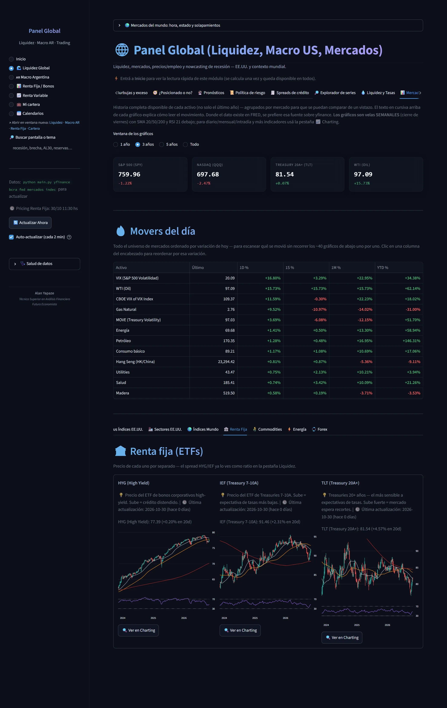

> Historia completa disponible de cada activo (no solo el último año) — agrupados por mercado para que se puedan comparar de un vistazo. El texto en cursiva arriba de cada gráfico explica cómo leer el movimiento. Donde el dato existe en FRED, se prefiere esa fuente sobre yfinance. Los gráficos son velas SEMANALES (cierre de viernes) con SMA 20/50/200 y RSI 21 debajo; para diario/mensual/intradía y más indicadores usá l Todo el universo de mercados ordenado por variación de hoy — para escanear qué se movió sin recorrer los ~40 gráficos de abajo uno por uno. Clic en una columna del encabezado para reordenar por esa variación.

## Mercados › Commodities

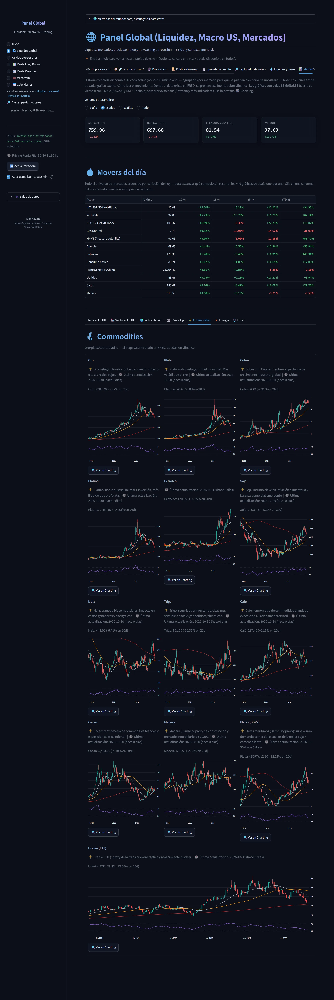

> Historia completa disponible de cada activo (no solo el último año) — agrupados por mercado para que se puedan comparar de un vistazo. El texto en cursiva arriba de cada gráfico explica cómo leer el movimiento. Donde el dato existe en FRED, se prefiere esa fuente sobre yfinance. Los gráficos son velas SEMANALES (cierre de viernes) con SMA 20/50/200 y RSI 21 debajo; para diario/mensual/intradía y más indicadores usá l Todo el universo de mercados ordenado por variación de hoy — para escanear qué se movió sin recorrer los ~40 gráficos de abajo uno por uno. Clic en una columna del encabezado para reordenar por esa variación.

## Mercados › Energía

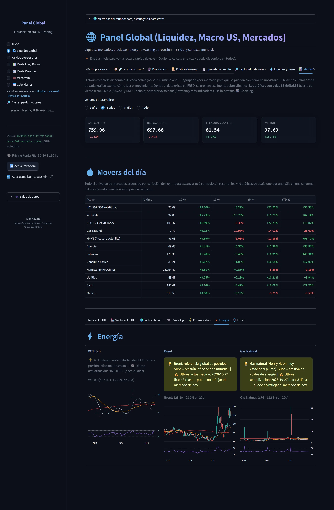

> Historia completa disponible de cada activo (no solo el último año) — agrupados por mercado para que se puedan comparar de un vistazo. El texto en cursiva arriba de cada gráfico explica cómo leer el movimiento. Donde el dato existe en FRED, se prefiere esa fuente sobre yfinance. Los gráficos son velas SEMANALES (cierre de viernes) con SMA 20/50/200 y RSI 21 debajo; para diario/mensual/intradía y más indicadores usá l Todo el universo de mercados ordenado por variación de hoy — para escanear qué se movió sin recorrer los ~40 gráficos de abajo uno por uno. Clic en una columna del encabezado para reordenar por esa variación.

## Mercados › Forex

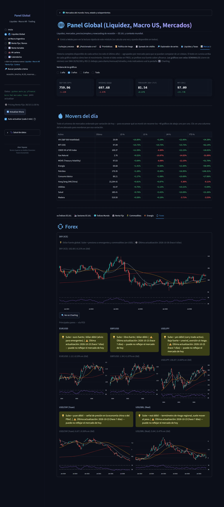

> Historia completa disponible de cada activo (no solo el último año) — agrupados por mercado para que se puedan comparar de un vistazo. El texto en cursiva arriba de cada gráfico explica cómo leer el movimiento. Donde el dato existe en FRED, se prefiere esa fuente sobre yfinance. Los gráficos son velas SEMANALES (cierre de viernes) con SMA 20/50/200 y RSI 21 debajo; para diario/mensual/intradía y más indicadores usá l Todo el universo de mercados ordenado por variación de hoy — para escanear qué se movió sin recorrer los ~40 gráficos de abajo uno por uno. Clic en una columna del encabezado para reordenar por esa variación.

## Charting

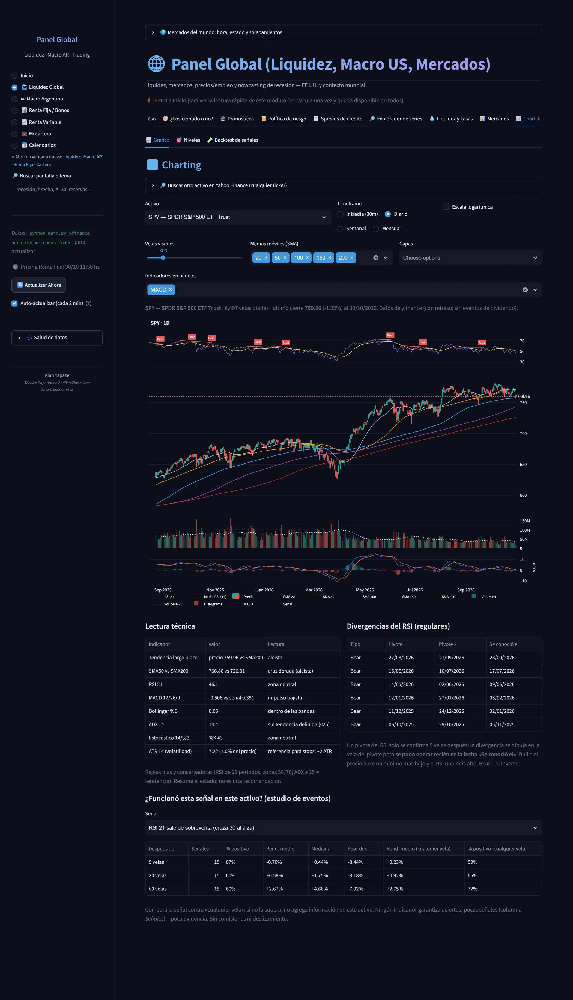

> SPY — SPDR S&P 500 ETF Trust · 8,497 velas diarias · último cierre 759.96 (-1.22%) al 30/10/2026. Datos de yfinance (con retraso; sin eventos de dividendo). Reglas fijas y conservadoras (RSI de 21 períodos, zonas 30/70; ADX ≥ 25 = tendencia). Resume el estado; no es una recomendación.

## Charting › Niveles

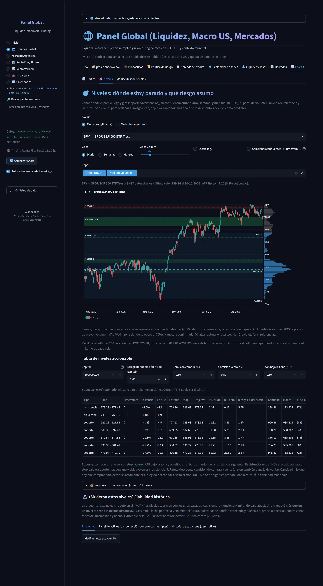

> Zonas donde el precio llegó y giró (soportes/resistencias), su confluencia entre diario, semanal y mensual (D+S+M), el perfil de volumen, niveles de referencia y rupturas. Son niveles para ordenar el riesgo (stop, objetivo, tamaño): más abajo se mide cuánto sirvieron como predictor. SPY — SPDR S&P 500 ETF Trust · 8,497 datos diarios · último valor 759.96 al 30/10/2026 · ATR típico ≈ 7.22 (0.9% del precio).

## Charting › Backtest de señales

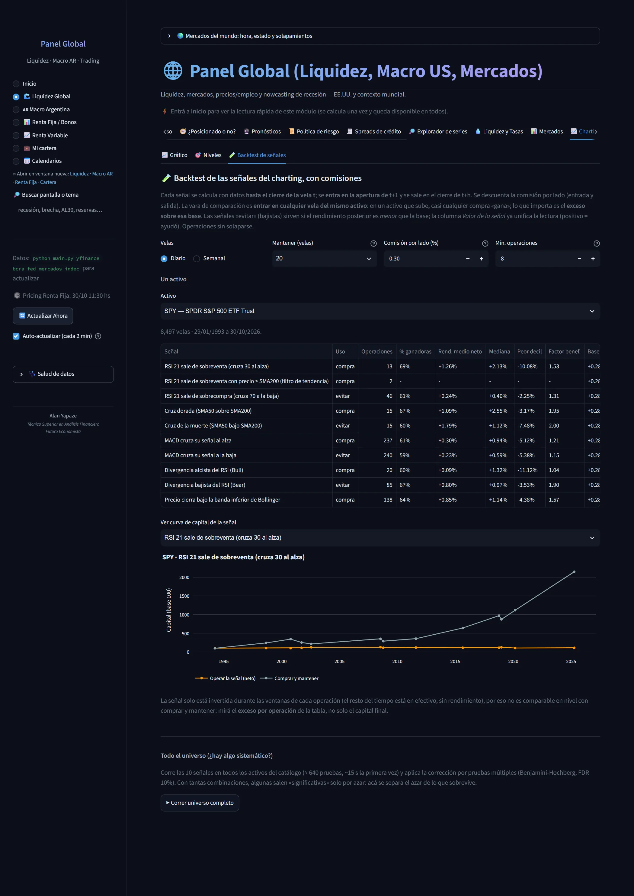

> Cada señal se calcula con datos hasta el cierre de la vela t; se entra en la apertura de t+1 y se sale en el cierre de t+h. Se descuenta la comisión por lado (entrada y salida). La vara de comparación es entrar en cualquier vela del mismo activo: en un activo que sube, casi cualquier compra «gana»; lo que importa es el exceso sobre esa base. Las señales «evitar» (bajistas) sirven si el rendimiento posterior es menor  La señal solo está invertida durante las ventanas de cada operación (el resto del tiempo está en efectivo, sin rendimiento), por eso no es comparable en nivel con comprar y mantener: mirá el exceso por operación de la tabla, no solo el capital final.

## Macro EE.UU.

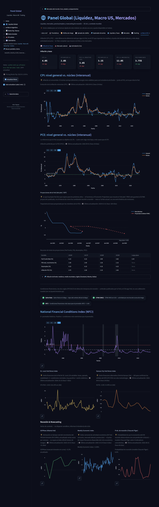

> Inflación (CPI y PCE — esta última es la referencia real que sigue la Fed, no el CPI que reportan los medios), el pulso del mercado laboral, y más abajo actividad/consumo — la 'foto completa' que mueve a la Fed y a los mercados. 💡 Inflación al consumidor. El núcleo excluye alimentos y energía (más volátiles) para ver la tendencia de fondo — junto al PCE, es lo que mira la Fed.

## Macro EE.UU. › Mercado Laboral

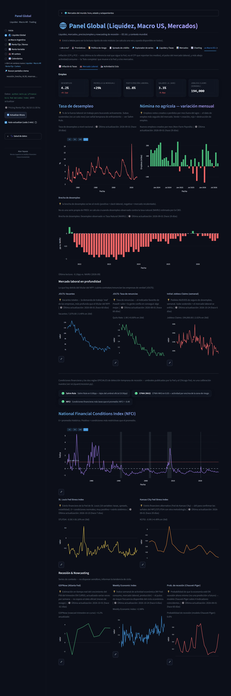

> Inflación (CPI y PCE — esta última es la referencia real que sigue la Fed, no el CPI que reportan los medios), el pulso del mercado laboral, y más abajo actividad/consumo — la 'foto completa' que mueve a la Fed y a los mercados. 💡 % de la fuerza laboral sin trabajo pero buscando activamente. Subas sostenidas (no un solo mes) son señal temprana de enfriamiento — ver Sahm Rule.

## Macro EE.UU. › Actividad & Ciclo

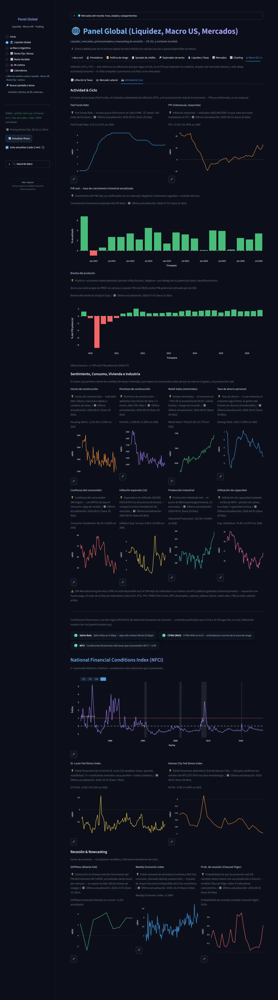

> Inflación (CPI y PCE — esta última es la referencia real que sigue la Fed, no el CPI que reportan los medios), el pulso del mercado laboral, y más abajo actividad/consumo — la 'foto completa' que mueve a la Fed y a los mercados. El motor de las tasas (Fed Funds), el indicador adelantado de inflación (PPI), y el consumo/ciclo real de la economía — PIB ya confirmado, no un nowcast.

## Economía Real

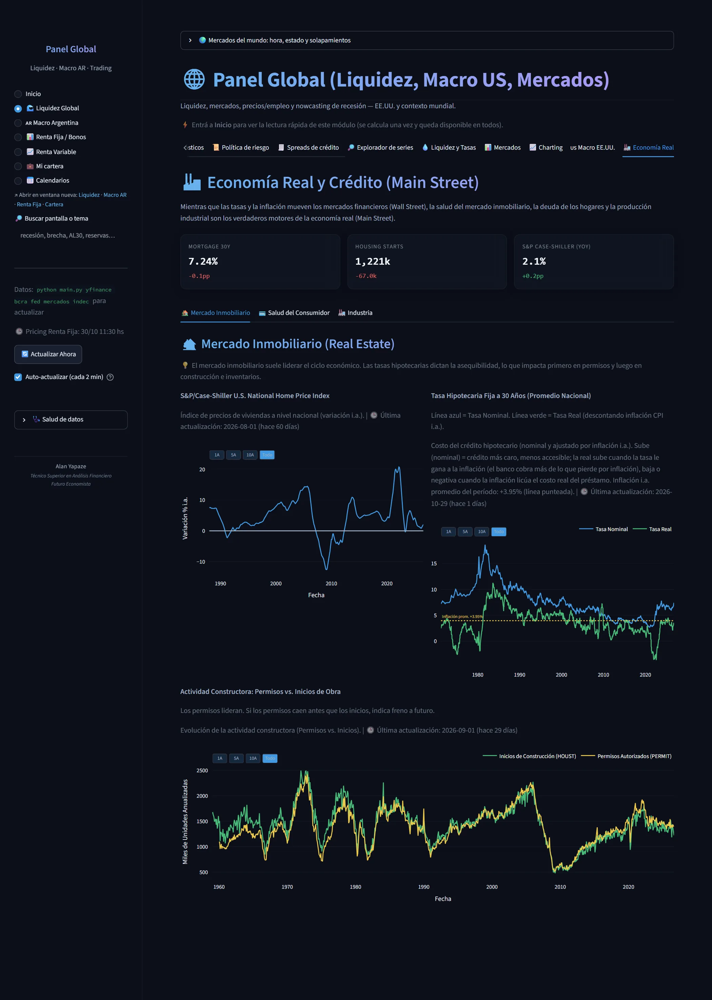

> 💡 El mercado inmobiliario suele liderar el ciclo económico. Las tasas hipotecarias dictan la asequibilidad, lo que impacta primero en permisos y luego en construcción e inventarios. Índice de precios de viviendas a nivel nacional (variación i.a.). | 🕒 Última actualización: 2026-08-01 (hace 60 días)

## Economía Real › Salud del Consumidor

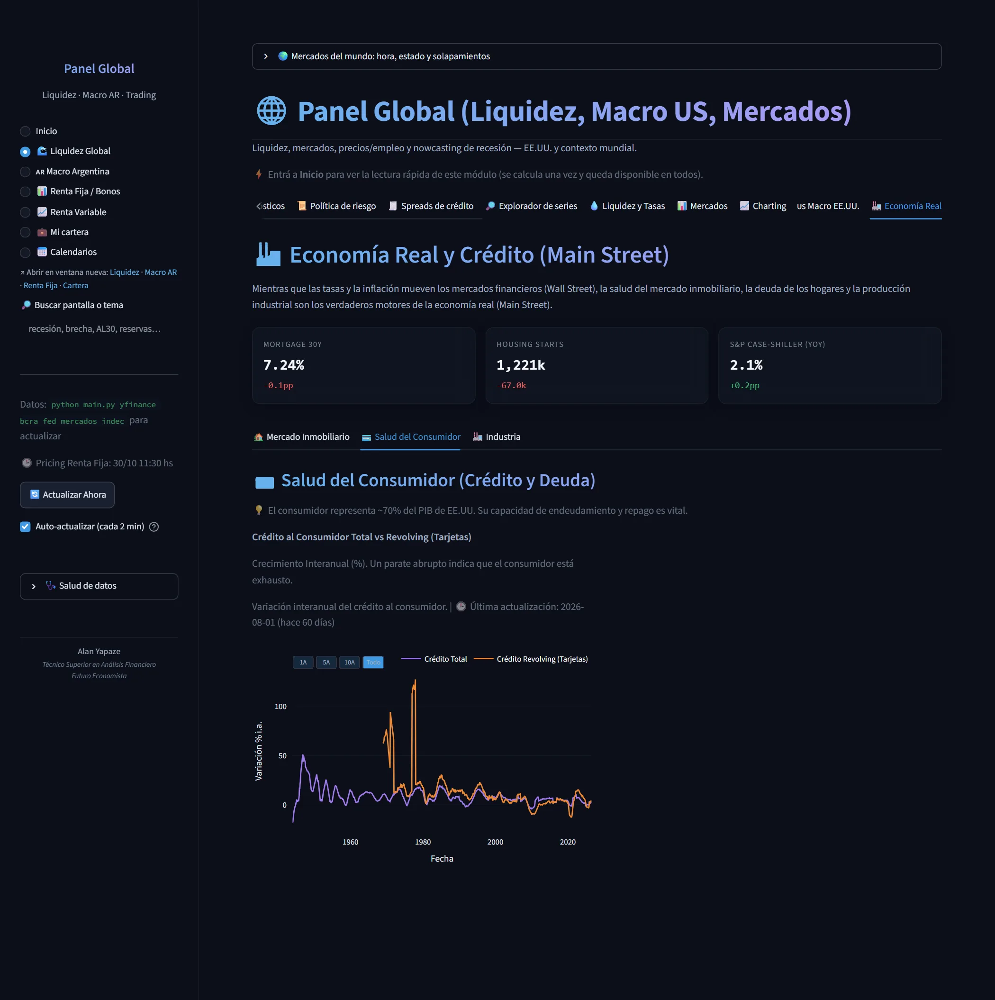

> 💡 El consumidor representa ~70% del PIB de EE.UU. Su capacidad de endeudamiento y repago es vital. Crecimiento Interanual (%). Un parate abrupto indica que el consumidor está exhausto.

## Economía Real › Industria

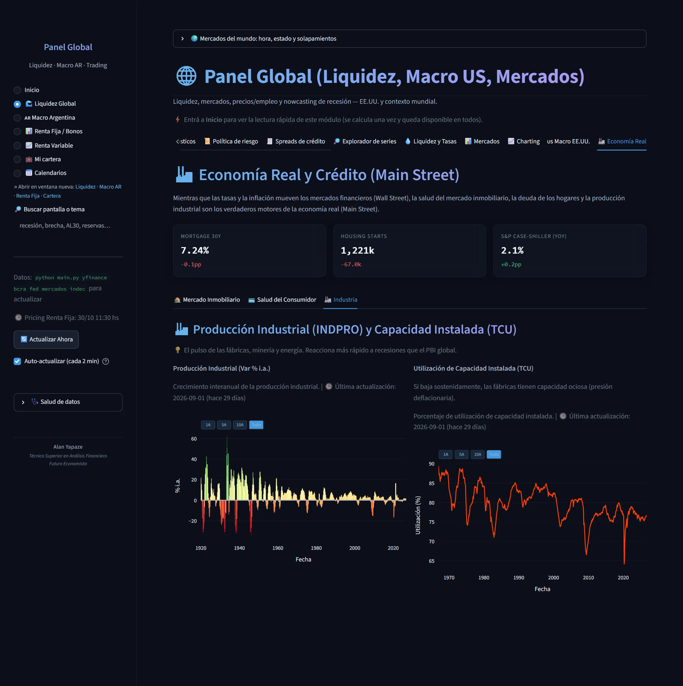

> 💡 El pulso de las fábricas, minería y energía. Reacciona más rápido a recesiones que el PBI global. Crecimiento interanual de la producción industrial. | 🕒 Última actualización: 2026-09-01 (hace 29 días)
