# 🇦🇷 Macro Argentina

La economía real y financiera del país con datos oficiales: postura monetaria, cambiario, reservas, fiscal, monetario, crédito y bancos, actividad, precios, empleo, consumo, externo y expectativas.

**19 pantallas.** [Volver al índice](README.md) · [Inicio del repositorio](../../README.md)

> ℹ️ **Sobre estas capturas:** muestran una herramienta de análisis con datos de mercado del día. Los tickers, rendimientos y señales que aparecen son resultados del cálculo para ilustrar su funcionamiento: **no son recomendaciones de inversión** ni ofertas de compra o venta.

## Salud económica

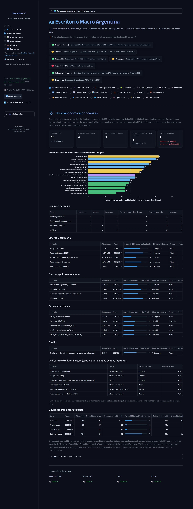

> Cada indicador contra su propia década: dónde está hoy (percentil: 100 = el mejor momento de los últimos 10 años), hacia dónde va (cambio a 3 meses) y cuán fresco es el dato. Los semáforos de arriba usan umbrales fijos que, probados desde 2014, estuvieron en rojo el 65 % del tiempo y no distinguen períodos; acá la vara es la propia historia reciente. Describe, no predice. «Cambio relativo» = cambio a 3 meses dividido por el rango intercuartil de la década: 1 significa que se movió tanto como el rango típico entre un año bueno y uno malo.

## Ciclo de actividad

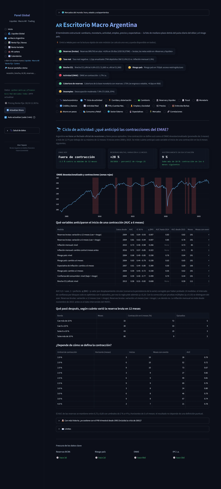

> Argentina no tiene un fechado oficial de recesiones y tiene pocos episodios. Una contracción se define acá como el EMAE desestacionalizado (promedio de 3 meses) a más de 2,5 % por debajo de su máximo de 12 meses: 9 inicios entre 2008 y 2023. Se mide cuánto anticipó cada variable el inicio de una contracción en los 6 meses siguientes. AUC 0,5 = azar, 1 = perfecto. q (BH) = p-valor por desplazamiento circular (conserva la persistencia de la serie) corregido por haber probado 14 medidas: el intervalo de confianza por bloques solo es optimista con 9 episodios, por eso la regla pide además q ≤ 0,10.

## Corridas y dolarización

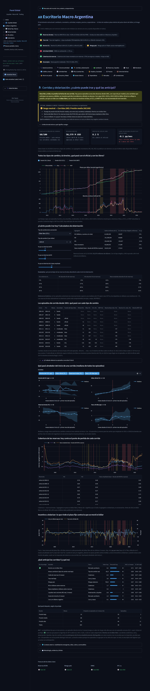

> Datos hasta 27/10/2026 (reservas y tipos de cambio). Los agregados monetarios (M1, M2, M3) se publican con demora: se usa el último dato disponible (hasta 3 meses atrás) y se marca la fecha real. Las franjas rojas son episodios fuertes y las amarillas, moderados. En 2011-2015 y 2019-2025 el oficial se movió poco mientras el blue, el CCL y el MEP absorbían la presión: la brecha llegó a 140 % en 2023. Hoy está lejos de esos niveles.

## Cambiario

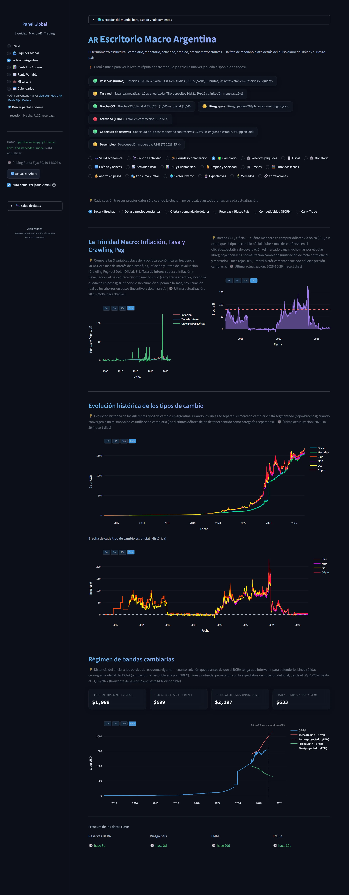

> 💡 Cada sección trae sus propios datos sólo cuando la elegís — no se recalculan todas juntas en cada actualización. 💡 Compara las 3 variables clave de la política económica en frecuencia MENSUAL: Tasa de interés de plazos fijos, Inflación y Ritmo de Devaluación (Crawling Peg) del Dólar Oficial.

## Reservas y liquidez

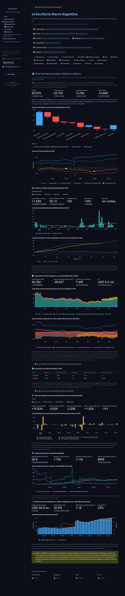

> Datos al 27/10/2026 (último dato publicado por el BCRA). Millones de USD. Reservas netas reconstruidas a partir de datos oficiales; ver «Cómo se computan» y las fuentes de cada partida. 🟢 Se actualizan solas con la descarga diaria del BCRA: niveles 1 y 2, compras del BCRA, factores y cobertura.

## Fiscal

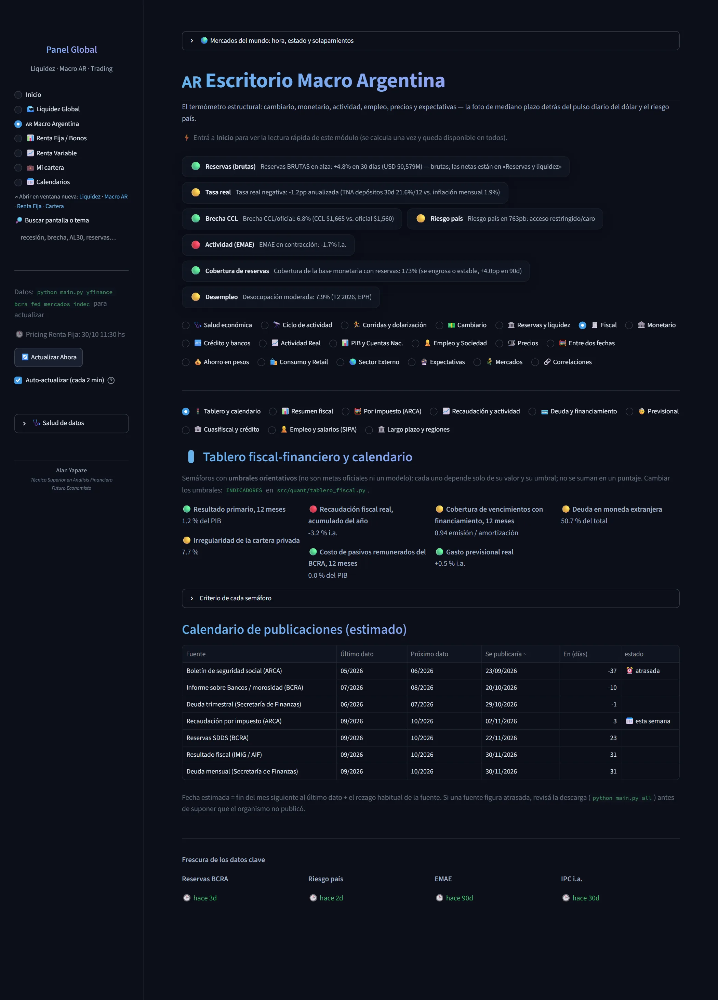

> Semáforos con umbrales orientativos (no son metas oficiales ni un modelo): cada uno depende solo de su valor y su umbral; no se suman en un puntaje. Fecha estimada = fin del mes siguiente al último dato + el rezago habitual de la fuente.

## Monetario

*Pantalla larga: se muestra en 2 partes, de arriba hacia abajo.*

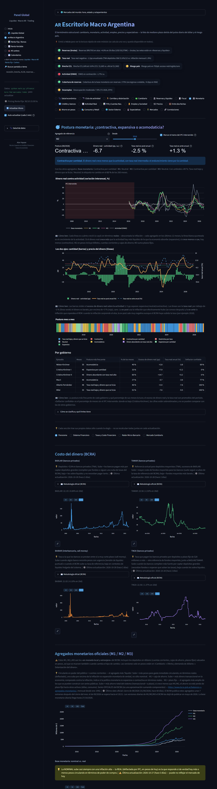

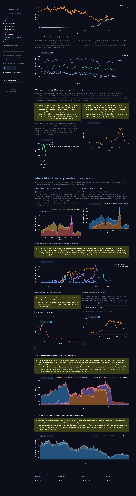

> Con los otros agregados: Base monetaria: Contractiva por cantidad · M1: Neutral · M2: Contractiva por cantidad · M3: Neutral. Con umbrales ±40 %: Tasa real baja y dinero que se licúa / Neutral; la etiqueta no cambia en el 63 % de los 260 meses. 📖 Cómo leer. Cada línea es cuánto creció (o cayó) en términos reales —descontada la inflación— cada agregado en los últimos 12 meses; la línea blanca punteada es el crecimiento de la actividad. Si el dinero real crece más que la actividad hay más liquidez de la que la economía absorbe (expansivo); si crece menos o cae, hay menos (contractivo).

## Crédito y bancos

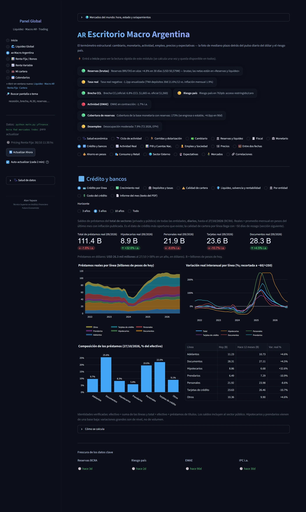

> Saldos de préstamos del total de sectores (privado y público) de todas las entidades, diarios, hasta el 27/10/2026 (BCRA). Reales = promedio mensual en pesos del último mes con inflación publicada. Es el dato de crédito más oportuno que existe; la calidad de cartera por línea llega con ~50 días de rezago (sección siguiente). Préstamos en dólares: USD 26.3 mil millones al 27/10 (+38% en un año, en dólares). B = billones de pesos de hoy.

## Actividad Real

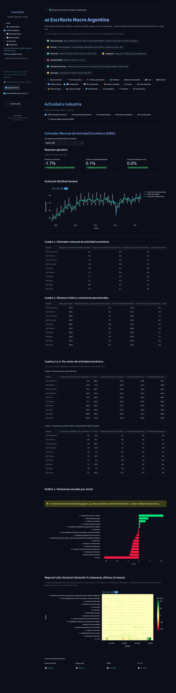

> Evolución del nivel de actividad y variaciones interanuales por sector (letras CIIU). Complementa el gráfico de arriba (que sólo muestra el último dato) con la evolución en el tiempo de cada sector — qué rama viene sosteniendo o frenando la actividad, no sólo cómo cerró el último mes.

## PIB y Cuentas Nac.

*Pantalla larga: se muestra en 2 partes, de arriba hacia abajo.*

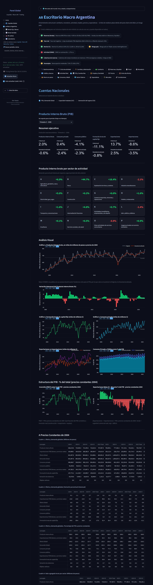

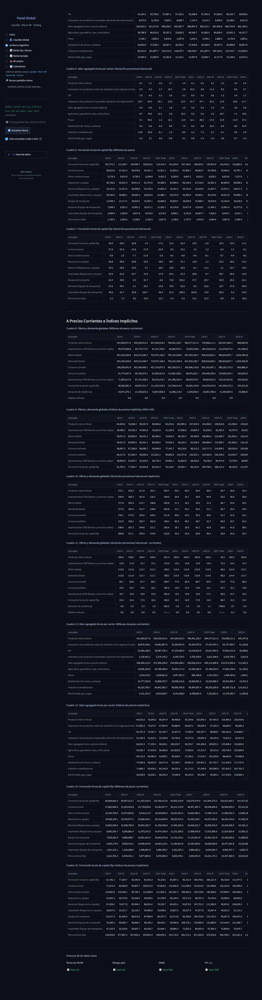

> Variación porcentual interanual respecto a igual período del año anterior Nota: El INDEC no publica en sus anexos Excel la serie Tendencia-ciclo para el PIB, por lo que solo se muestran la Original y la Desestacionalizada.

## Empleo y Sociedad

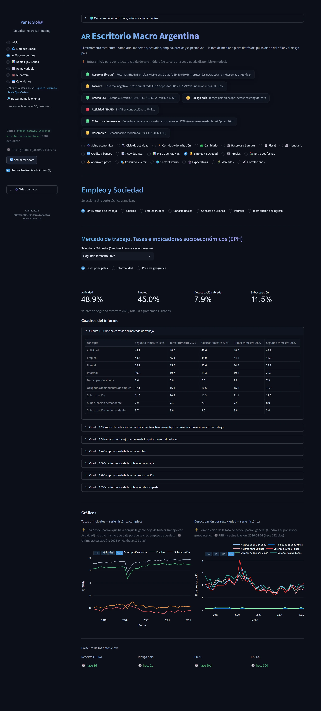

> Valores de Segundo trimestre 2026, Total 31 aglomerados urbanos. 💡 Una desocupación que baja porque la gente deja de buscar trabajo (cae Actividad) no es lo mismo que baje porque se creó empleo de verdad. | 🕒 Última actualización: 2026-04-01 (hace 122 días)

## Precios

*Pantalla larga: se muestra en 2 partes, de arriba hacia abajo.*

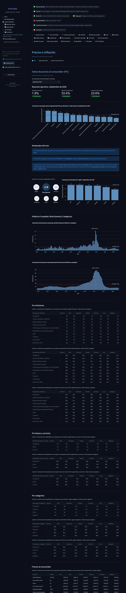

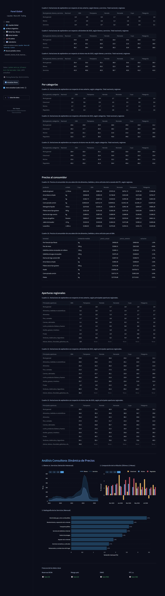

> El nivel general del Índice de precios al consumidor registró un alza mensual de 1.9% en septiembre de 2026, y acumuló en el año una variación de 23.6%. A nivel de las categorías, los precios del IPC Núcleo (1.7%), Regulados (2.3%) y Estacionales (2.9%) marcaron la tendencia del mes.

## Entre dos fechas

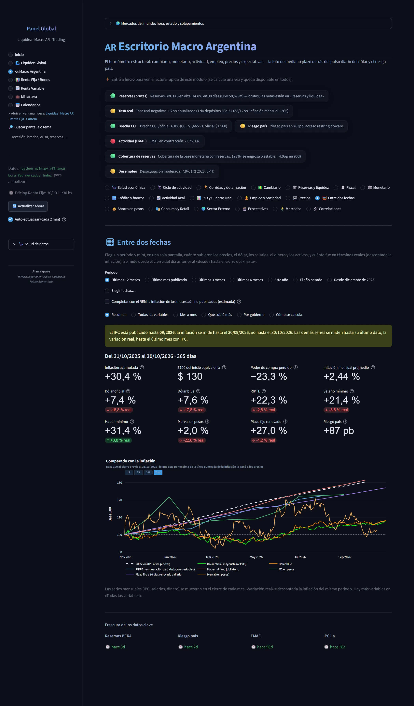

> Elegí un período y mirá, en una sola pantalla, cuánto subieron los precios, el dólar, los salarios, el dinero y los activos, y cuánto fue en términos reales (descontada la inflación). Se mide desde el cierre del día anterior al «desde» hasta el cierre del «hasta». Las series mensuales (IPC, salarios, dinero) se muestran en el cierre de cada mes. «Variación real» = descontada la inflación del mismo período. Hay más variables en «Todas las variables».

## Ahorro en pesos

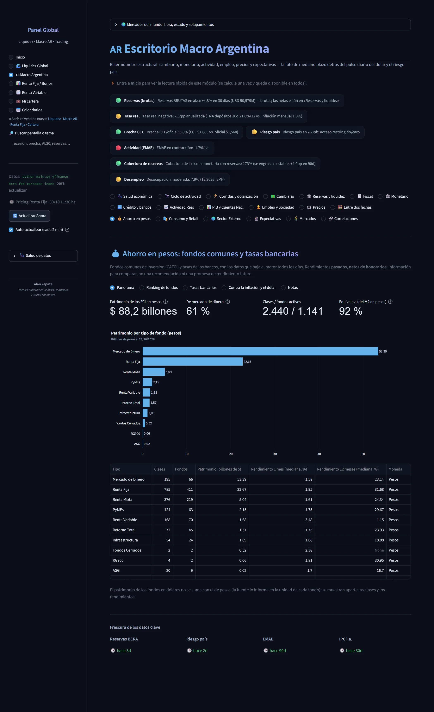

> Fondos comunes de inversión (CAFCI) y tasas de los bancos, con los datos que baja el motor todos los días. Rendimientos pasados, netos de honorarios: información para comparar, no una recomendación ni una promesa de rendimiento futuro. El patrimonio de los fondos en dólares no se suma con el de pesos (la fuente lo informa en la unidad de cada fondo); se muestran aparte las clases y los rendimientos.

## Consumo y Retail

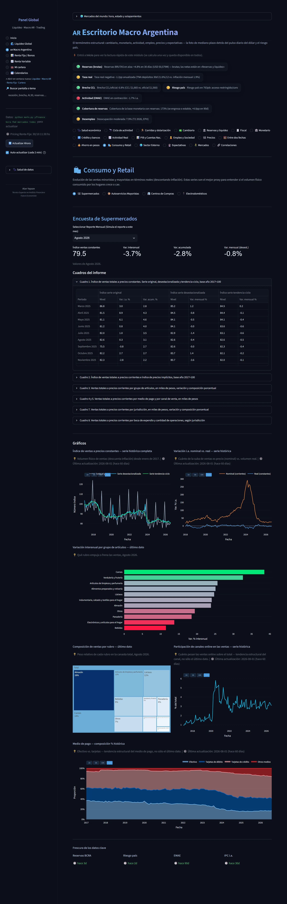

> 💡 Volumen físico de ventas (descuenta inflación) desde enero de 2017. | 🕒 Última actualización: 2026-08-01 (hace 60 días) 💡 Cuánto de la suba de ventas es precio (nominal) vs. volumen real. | 🕒 Última actualización: 2026-08-01 (hace 60 días)

## Sector Externo

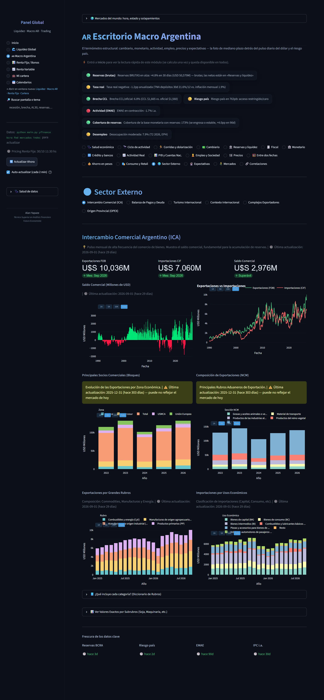

> 💡 Pulso mensual de alta frecuencia del comercio de bienes. Muestra el saldo comercial, fundamental para la acumulación de reservas. | 🕒 Última actualización: 2026-09-01 (hace 29 días) | 🕒 Última actualización: 2026-09-01 (hace 29 días)

## Expectativas

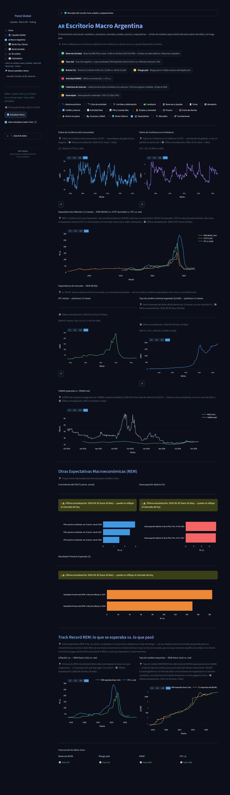

> 💡 Índice de Confianza del Consumidor (UTDT) — expectativas de gasto de los hogares. | 🕒 Última actualización: 2026-10-01 (hace 0 días) 💡 Índice de Confianza en el Gobierno (UTDT) — percepción de gestión, no de un partido en particular. | 🕒 Última actualización: 2026-10-01 (hace 0 días)

## Mercados

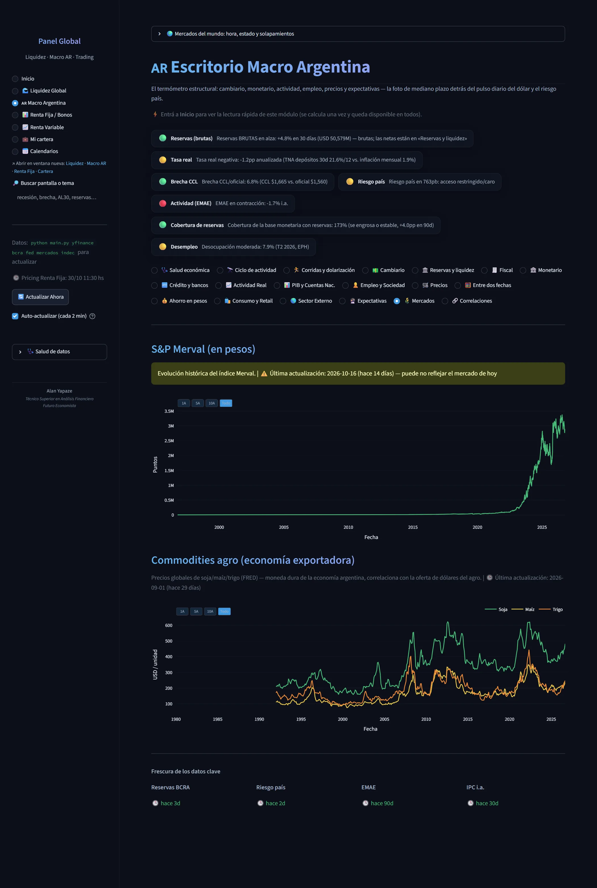

> Precios globales de soja/maíz/trigo (FRED) — moneda dura de la economía argentina, correlaciona con la oferta de dólares del agro. | 🕒 Última actualización: 2026-09-01 (hace 29 días) Evolución histórica del índice Merval. | ⚠️ Última actualización: 2026-10-16 (hace 14 días) — puede no reflejar el mercado de hoy

## Correlaciones

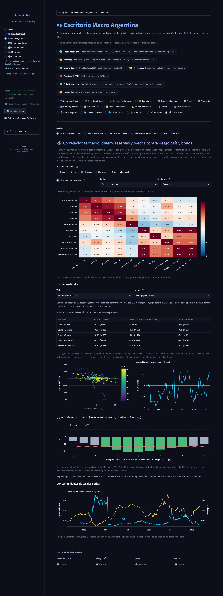

> ¿Se mueven juntos las reservas, la base monetaria o M1/M2/M3 con el riesgo país y los rendimientos de los bonos? Se miden los cambios a un horizonte elegible (1 a 12 meses): el cambio de un mes es muy ruidoso y puede esconder una relación de fondo que aparece a 3-12 meses. Cada resultado dice cuántos meses tiene y si es significativo (|t| ≥ 2, con n efectivo cuando los cambios se solapan). 10 series · 08/1992 a 09/2026 · agregados monetarios hasta el último mes publicado · cambios a 6 meses.
