# 📊 Renta Fija / Bonos

Pricing de 7 tipos de instrumento en tres vistas de precio, curvas, valor relativo, arbitraje, carry trade, armador de portafolios y fichas por bono.

**24 pantallas.** [Volver al índice](README.md) · [Inicio del repositorio](../../README.md)

> ℹ️ **Sobre estas capturas:** muestran una herramienta de análisis con datos de mercado del día. Los tickers, rendimientos y señales que aparecen son resultados del cálculo para ilustrar su funcionamiento: **no son recomendaciones de inversión** ni ofertas de compra o venta.

## Pulso del día › Qué cambió hoy

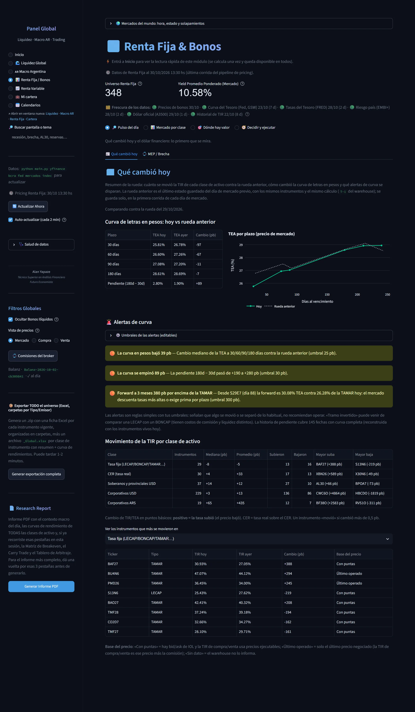

> Qué cambió hoy: la variación de la TIR de cada clase de instrumento contra la rueda anterior, las curvas de hoy y de ayer y las alertas con umbrales editables.

## Pulso del día › MEP / Brecha

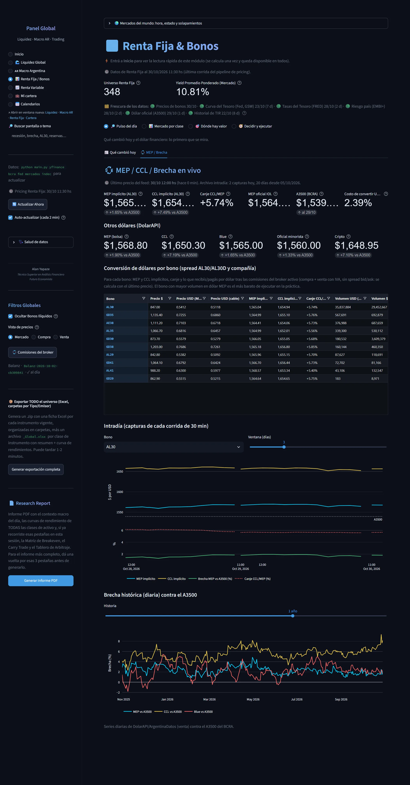

> MEP y brecha en vivo: el dólar implícito en los bonos (según la fuente de precio disponible: API del broker, ratio AL30/GD30 o A3500) y su brecha contra el dólar oficial.

## Mercado por clase › Tasa Fija

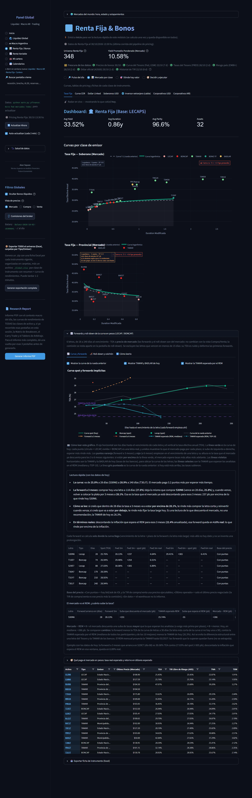

> Tasa fija en pesos: curvas por clase de emisor (soberano, provincial, corporativo), tabla de pricing con TEA, TNA, duration, convexidad y breakeven de dólar, forwards implícitas con roll-down y prima en pesos.

## Mercado por clase › Curva CER

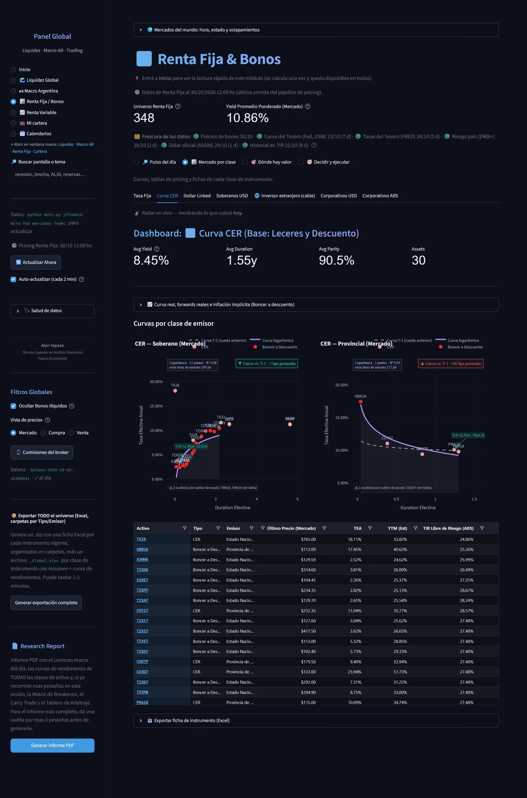

> Bonos ajustados por CER: curva real por clase de emisor, inflación implícita contra el REM por plazo y tabla de pricing con TIR real y sensibilidades.

## Mercado por clase › Dollar Linked

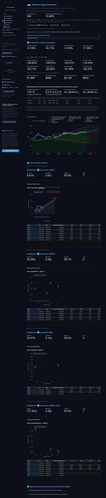

> Dollar Linked: evolución y política cambiaria, curvas por escenario de dólar (A3500, ROFEX, REM y banda), la banda propia y qué descuenta el mercado con estos bonos.

## Mercado por clase › Dollar Linked › Minorista

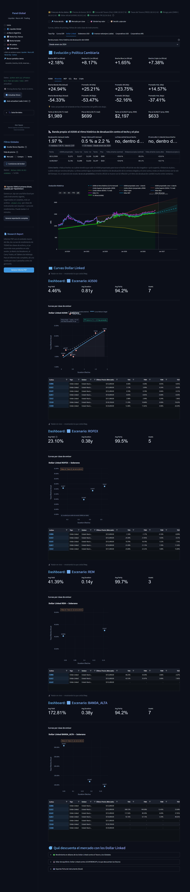

> Evolución y política cambiaria del dólar minorista, una de las referencias que enmarcan el Dollar Linked.

## Mercado por clase › Dollar Linked › MEP

> Evolución y política cambiaria del dólar MEP, una de las referencias que enmarcan el Dollar Linked.

## Mercado por clase › Dollar Linked › CCL

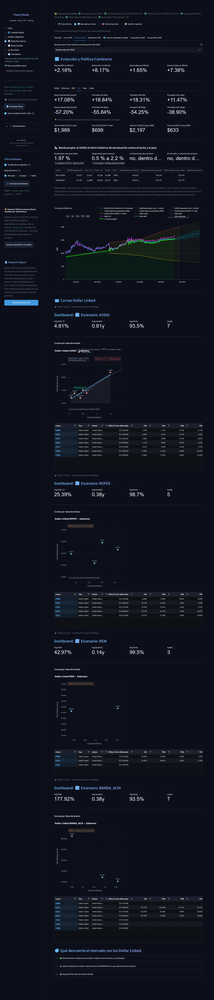

> Evolución y política cambiaria del dólar contado con liquidación (CCL), una de las referencias que enmarcan el Dollar Linked.

## Mercado por clase › Dollar Linked › Blue

> Evolución y política cambiaria del dólar blue, una de las referencias que enmarcan el Dollar Linked.

## Mercado por clase › Dollar Linked › Cripto

> Evolución y política cambiaria del dólar cripto, una de las referencias que enmarcan el Dollar Linked.

## Mercado por clase › Soberanos USD

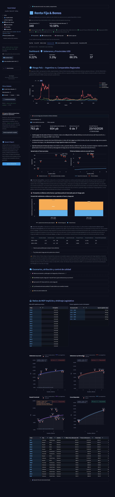

> Soberanos y provinciales en dólares: riesgo país, spread sobre el Tesoro, forwards, escenarios de retorno, curvas por ley (local y Nueva York), Bopreales y deuda provincial, MEP implícito y premio legislativo.

## Mercado por clase › Inversor extranjero (cable)

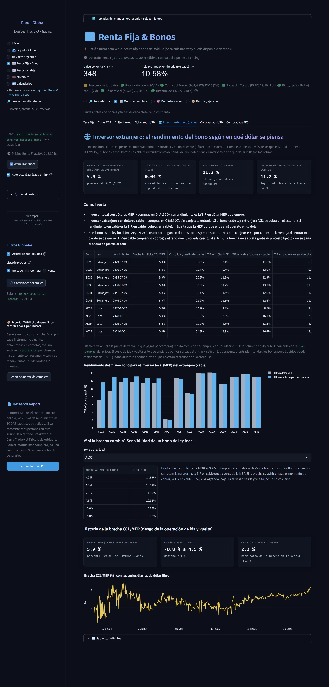

> Inversor extranjero: el rendimiento de un bono según el dólar con que se lo mire (cable, MEP o el canje entre ambos), la sensibilidad a la brecha CCL/MEP y su historia.

## Mercado por clase › Corporativos USD

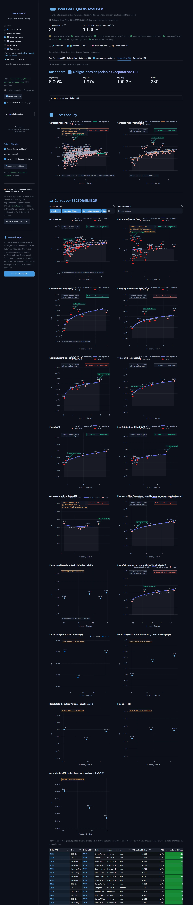

> Obligaciones negociables en dólares: curvas por ley y por sector, ranking de rendimiento por grupo y tabla de pricing de cada emisión.

## Mercado por clase › Corporativos ARS

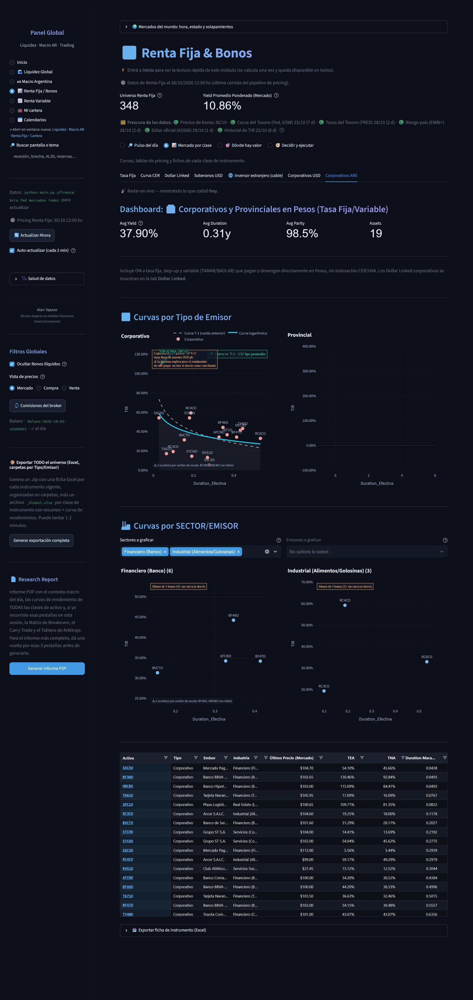

> Corporativos y provinciales en pesos a tasa fija o variable (TAMAR y BADLAR): curvas por clase de emisor y tabla de pricing.

## Dónde hay valor › Síntesis

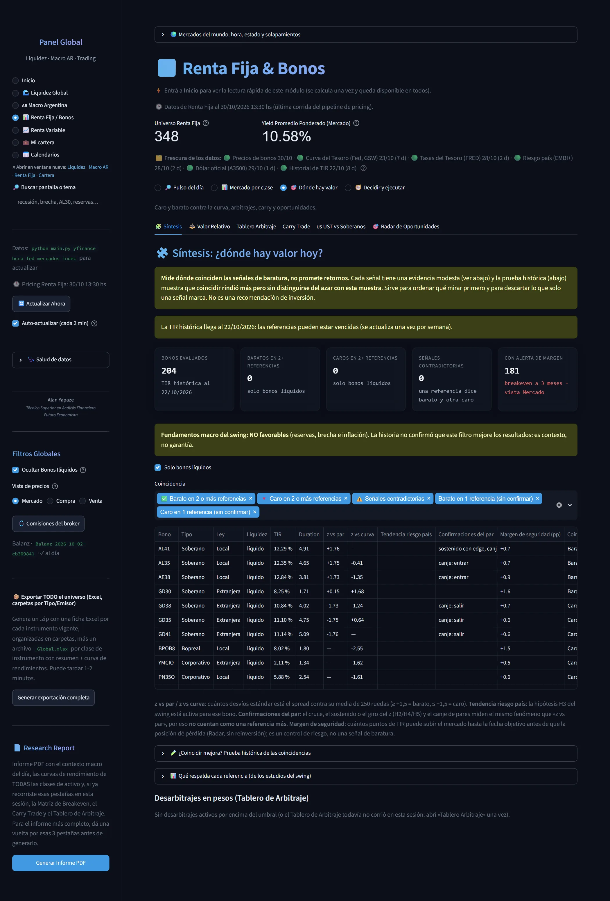

> Síntesis de las señales de valor: reúne lo que marcan el valor relativo, el tablero de arbitraje y el radar, con el grado de evidencia de cada una. No es una recomendación.

## Dónde hay valor › Valor Relativo

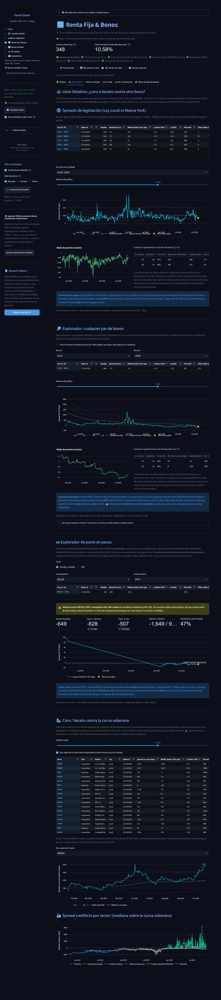

> Valor relativo: cada bono contra la curva soberana (medido contra la curva sin él mismo), spreads de legislación Ley Local contra Nueva York con estudio de eventos, spread por sector y explorador de pares.

## Dónde hay valor › Tablero Arbitraje

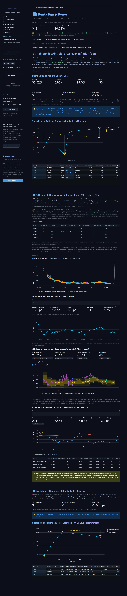

> Tablero de arbitraje: breakeven de inflación (ajustados por CER contra tasa fija) y arbitraje de dólar sintético (Dollar Linked contra tasa fija), con la superficie de arbitraje por plazo.

## Dónde hay valor › Carry Trade

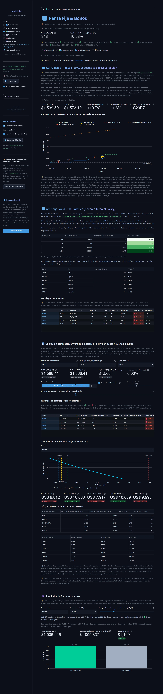

> Carry trade: la tasa fija contra las expectativas de devaluación, con las cuatro patas de conversión, el breakeven contra REM, ROFEX y banda cambiaria, el yield en dólares sintético y un simulador.

## Dónde hay valor › UST vs Soberanos

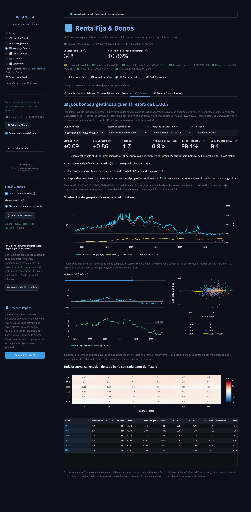

> Soberanos contra el Tesoro de EE.UU.: la TIR de cada grupo contra el Tesoro de igual duration y la correlación de cada bono con cada tenor, para probar si siguen al Tesoro.

## Dónde hay valor › Radar de Oportunidades

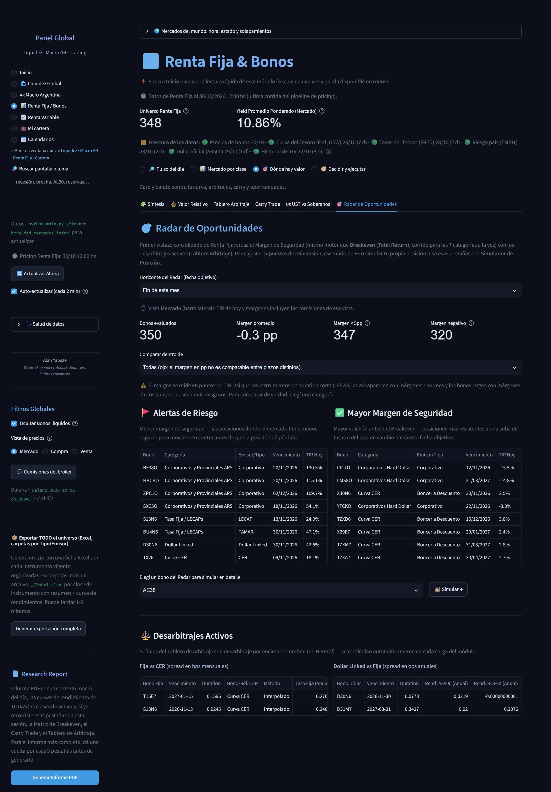

> Radar: alertas de riesgo, bonos con mayor margen de seguridad y desarbitrajes activos, con los mismos cálculos de las demás pantallas.

## Decidir y ejecutar › Breakeven (Total Return)

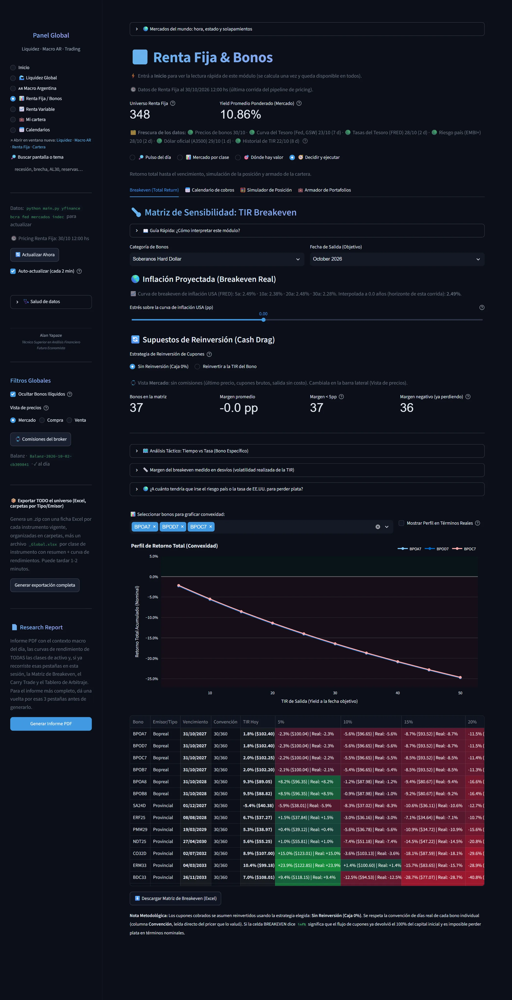

> Matriz de sensibilidad (TIR breakeven): el retorno total de comprar hoy y vender en una fecha, contra una grilla de TIR de salida y tres estrategias de reinversión de cupones.

## Decidir y ejecutar › Calendario de cobros

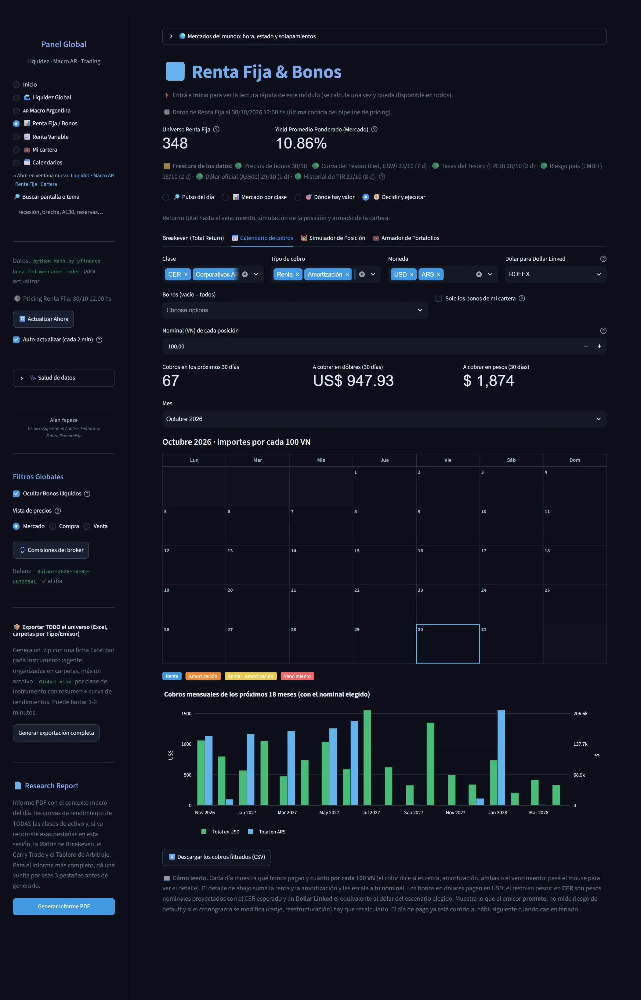

> Calendario de cobros: qué bonos pagan cada día y cuánto, con renta, amortización y vencimiento diferenciados, escalado a un nominal.

## Decidir y ejecutar › Simulador de Posición

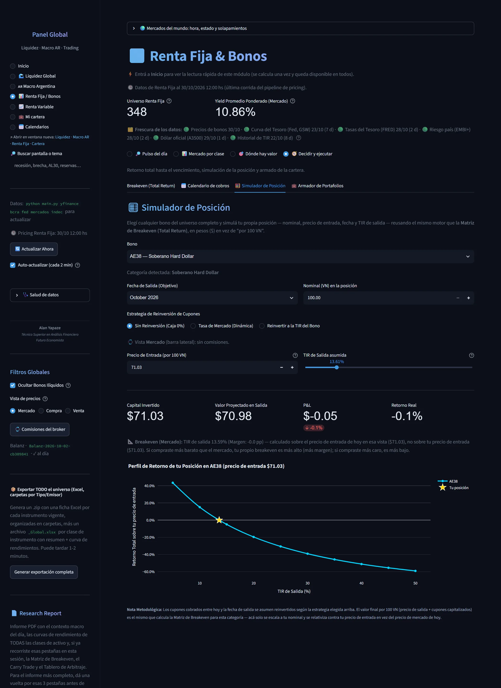

> Simulador de posición: el resultado neto de comisiones de comprar un nominal hoy y salir en una fecha.

## Decidir y ejecutar › Armador de Portafolios

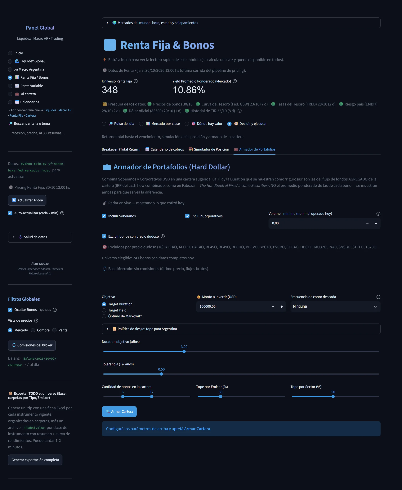

> Armador de portafolios: Markowitz con topes por emisor y sector, nominales con comisiones incluidas, estrés de tasa, frontera eficiente y backtest. El recorrido completo está en «Herramientas clave».
