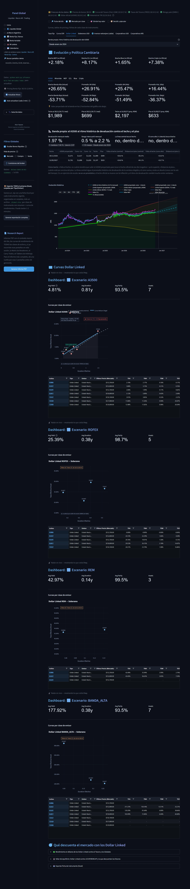

# 📊 Renta Fija / Bonos

Pricing de 7 tipos de instrumento en tres vistas de precio, curvas, valor relativo, arbitraje, carry trade, armador de portafolios y fichas por bono.

**25 pantallas.** [Volver al índice](README.md) · [Inicio del repositorio](../../README.md)

## Pulso del día › Qué cambió hoy

> 🕒 Datos de Renta Fija al 30/10/2026 11:30 hs (última corrida del pipeline de pricing). 🗂️ Frescura de los datos: 🟢 Precios de bonos 30/10 · 🟢 Curva del Tesoro (Fed, GSW) 23/10 (7 d) · 🟢 Tasas del Tesoro (FRED) 28/10 (2 d) · 🟢 Riesgo país (EMBI+) 28/10 (2 d) · 🟢 Dólar oficial (A3500) 29/10 (1 d) · 🟢 Historial de TIR 22/10 (8 d)

## Pulso del día › MEP / Brecha

> 🕒 Datos de Renta Fija al 30/10/2026 11:30 hs (última corrida del pipeline de pricing). 🗂️ Frescura de los datos: 🟢 Precios de bonos 30/10 · 🟢 Curva del Tesoro (Fed, GSW) 23/10 (7 d) · 🟢 Tasas del Tesoro (FRED) 28/10 (2 d) · 🟢 Riesgo país (EMBI+) 28/10 (2 d) · 🟢 Dólar oficial (A3500) 29/10 (1 d) · 🟢 Historial de TIR 22/10 (8 d)

## Mercado por clase › Tasa Fija

> 🕒 Datos de Renta Fija al 30/10/2026 12:00 hs (última corrida del pipeline de pricing). 🗂️ Frescura de los datos: 🟢 Precios de bonos 30/10 · 🟢 Curva del Tesoro (Fed, GSW) 23/10 (7 d) · 🟢 Tasas del Tesoro (FRED) 28/10 (2 d) · 🟢 Riesgo país (EMBI+) 28/10 (2 d) · 🟢 Dólar oficial (A3500) 29/10 (1 d) · 🟢 Historial de TIR 22/10 (8 d)

## Mercado por clase › Curva CER

> 🕒 Datos de Renta Fija al 30/10/2026 12:00 hs (última corrida del pipeline de pricing). 🗂️ Frescura de los datos: 🟢 Precios de bonos 30/10 · 🟢 Curva del Tesoro (Fed, GSW) 23/10 (7 d) · 🟢 Tasas del Tesoro (FRED) 28/10 (2 d) · 🟢 Riesgo país (EMBI+) 28/10 (2 d) · 🟢 Dólar oficial (A3500) 29/10 (1 d) · 🟢 Historial de TIR 22/10 (8 d)

## Mercado por clase › Dollar Linked

> 🕒 Datos de Renta Fija al 30/10/2026 12:00 hs (última corrida del pipeline de pricing). 🗂️ Frescura de los datos: 🟢 Precios de bonos 30/10 · 🟢 Curva del Tesoro (Fed, GSW) 23/10 (7 d) · 🟢 Tasas del Tesoro (FRED) 28/10 (2 d) · 🟢 Riesgo país (EMBI+) 28/10 (2 d) · 🟢 Dólar oficial (A3500) 29/10 (1 d) · 🟢 Historial de TIR 22/10 (8 d)

## Mercado por clase › Dollar Linked › A3500

> 🕒 Datos de Renta Fija al 30/10/2026 12:00 hs (última corrida del pipeline de pricing). 🗂️ Frescura de los datos: 🟢 Precios de bonos 30/10 · 🟢 Curva del Tesoro (Fed, GSW) 23/10 (7 d) · 🟢 Tasas del Tesoro (FRED) 28/10 (2 d) · 🟢 Riesgo país (EMBI+) 28/10 (2 d) · 🟢 Dólar oficial (A3500) 29/10 (1 d) · 🟢 Historial de TIR 22/10 (8 d)

## Mercado por clase › Dollar Linked › Minorista

> 🕒 Datos de Renta Fija al 30/10/2026 12:00 hs (última corrida del pipeline de pricing). 🗂️ Frescura de los datos: 🟢 Precios de bonos 30/10 · 🟢 Curva del Tesoro (Fed, GSW) 23/10 (7 d) · 🟢 Tasas del Tesoro (FRED) 28/10 (2 d) · 🟢 Riesgo país (EMBI+) 28/10 (2 d) · 🟢 Dólar oficial (A3500) 29/10 (1 d) · 🟢 Historial de TIR 22/10 (8 d)

## Mercado por clase › Dollar Linked › MEP

> 🕒 Datos de Renta Fija al 30/10/2026 12:00 hs (última corrida del pipeline de pricing). 🗂️ Frescura de los datos: 🟢 Precios de bonos 30/10 · 🟢 Curva del Tesoro (Fed, GSW) 23/10 (7 d) · 🟢 Tasas del Tesoro (FRED) 28/10 (2 d) · 🟢 Riesgo país (EMBI+) 28/10 (2 d) · 🟢 Dólar oficial (A3500) 29/10 (1 d) · 🟢 Historial de TIR 22/10 (8 d)

## Mercado por clase › Dollar Linked › CCL

> 🕒 Datos de Renta Fija al 30/10/2026 12:00 hs (última corrida del pipeline de pricing). 🗂️ Frescura de los datos: 🟢 Precios de bonos 30/10 · 🟢 Curva del Tesoro (Fed, GSW) 23/10 (7 d) · 🟢 Tasas del Tesoro (FRED) 28/10 (2 d) · 🟢 Riesgo país (EMBI+) 28/10 (2 d) · 🟢 Dólar oficial (A3500) 29/10 (1 d) · 🟢 Historial de TIR 22/10 (8 d)

## Mercado por clase › Dollar Linked › Blue

> 🕒 Datos de Renta Fija al 30/10/2026 12:00 hs (última corrida del pipeline de pricing). 🗂️ Frescura de los datos: 🟢 Precios de bonos 30/10 · 🟢 Curva del Tesoro (Fed, GSW) 23/10 (7 d) · 🟢 Tasas del Tesoro (FRED) 28/10 (2 d) · 🟢 Riesgo país (EMBI+) 28/10 (2 d) · 🟢 Dólar oficial (A3500) 29/10 (1 d) · 🟢 Historial de TIR 22/10 (8 d)

## Mercado por clase › Dollar Linked › Cripto

> 🕒 Datos de Renta Fija al 30/10/2026 12:00 hs (última corrida del pipeline de pricing). 🗂️ Frescura de los datos: 🟢 Precios de bonos 30/10 · 🟢 Curva del Tesoro (Fed, GSW) 23/10 (7 d) · 🟢 Tasas del Tesoro (FRED) 28/10 (2 d) · 🟢 Riesgo país (EMBI+) 28/10 (2 d) · 🟢 Dólar oficial (A3500) 29/10 (1 d) · 🟢 Historial de TIR 22/10 (8 d)

## Mercado por clase › Soberanos USD

> 🕒 Datos de Renta Fija al 30/10/2026 12:00 hs (última corrida del pipeline de pricing). 🗂️ Frescura de los datos: 🟢 Precios de bonos 30/10 · 🟢 Curva del Tesoro (Fed, GSW) 23/10 (7 d) · 🟢 Tasas del Tesoro (FRED) 28/10 (2 d) · 🟢 Riesgo país (EMBI+) 28/10 (2 d) · 🟢 Dólar oficial (A3500) 29/10 (1 d) · 🟢 Historial de TIR 22/10 (8 d)

## Mercado por clase › Inversor extranjero (cable)

> 🕒 Datos de Renta Fija al 30/10/2026 12:00 hs (última corrida del pipeline de pricing). 🗂️ Frescura de los datos: 🟢 Precios de bonos 30/10 · 🟢 Curva del Tesoro (Fed, GSW) 23/10 (7 d) · 🟢 Tasas del Tesoro (FRED) 28/10 (2 d) · 🟢 Riesgo país (EMBI+) 28/10 (2 d) · 🟢 Dólar oficial (A3500) 29/10 (1 d) · 🟢 Historial de TIR 22/10 (8 d)

## Mercado por clase › Corporativos USD

> 🕒 Datos de Renta Fija al 30/10/2026 12:00 hs (última corrida del pipeline de pricing). 🗂️ Frescura de los datos: 🟢 Precios de bonos 30/10 · 🟢 Curva del Tesoro (Fed, GSW) 23/10 (7 d) · 🟢 Tasas del Tesoro (FRED) 28/10 (2 d) · 🟢 Riesgo país (EMBI+) 28/10 (2 d) · 🟢 Dólar oficial (A3500) 29/10 (1 d) · 🟢 Historial de TIR 22/10 (8 d)

## Mercado por clase › Corporativos ARS

> 🕒 Datos de Renta Fija al 30/10/2026 12:00 hs (última corrida del pipeline de pricing). 🗂️ Frescura de los datos: 🟢 Precios de bonos 30/10 · 🟢 Curva del Tesoro (Fed, GSW) 23/10 (7 d) · 🟢 Tasas del Tesoro (FRED) 28/10 (2 d) · 🟢 Riesgo país (EMBI+) 28/10 (2 d) · 🟢 Dólar oficial (A3500) 29/10 (1 d) · 🟢 Historial de TIR 22/10 (8 d)

## Dónde hay valor › Síntesis

> 🕒 Datos de Renta Fija al 30/10/2026 12:00 hs (última corrida del pipeline de pricing). 🗂️ Frescura de los datos: 🟢 Precios de bonos 30/10 · 🟢 Curva del Tesoro (Fed, GSW) 23/10 (7 d) · 🟢 Tasas del Tesoro (FRED) 28/10 (2 d) · 🟢 Riesgo país (EMBI+) 28/10 (2 d) · 🟢 Dólar oficial (A3500) 29/10 (1 d) · 🟢 Historial de TIR 22/10 (8 d)

## Dónde hay valor › Valor Relativo

> 🕒 Datos de Renta Fija al 30/10/2026 12:00 hs (última corrida del pipeline de pricing). 🗂️ Frescura de los datos: 🟢 Precios de bonos 30/10 · 🟢 Curva del Tesoro (Fed, GSW) 23/10 (7 d) · 🟢 Tasas del Tesoro (FRED) 28/10 (2 d) · 🟢 Riesgo país (EMBI+) 28/10 (2 d) · 🟢 Dólar oficial (A3500) 29/10 (1 d) · 🟢 Historial de TIR 22/10 (8 d)

## Dónde hay valor › Tablero Arbitraje

> 🕒 Datos de Renta Fija al 30/10/2026 12:00 hs (última corrida del pipeline de pricing). 🗂️ Frescura de los datos: 🟢 Precios de bonos 30/10 · 🟢 Curva del Tesoro (Fed, GSW) 23/10 (7 d) · 🟢 Tasas del Tesoro (FRED) 28/10 (2 d) · 🟢 Riesgo país (EMBI+) 28/10 (2 d) · 🟢 Dólar oficial (A3500) 29/10 (1 d) · 🟢 Historial de TIR 22/10 (8 d)

## Dónde hay valor › Carry Trade

> 🕒 Datos de Renta Fija al 30/10/2026 12:00 hs (última corrida del pipeline de pricing). 🗂️ Frescura de los datos: 🟢 Precios de bonos 30/10 · 🟢 Curva del Tesoro (Fed, GSW) 23/10 (7 d) · 🟢 Tasas del Tesoro (FRED) 28/10 (2 d) · 🟢 Riesgo país (EMBI+) 28/10 (2 d) · 🟢 Dólar oficial (A3500) 29/10 (1 d) · 🟢 Historial de TIR 22/10 (8 d)

## Dónde hay valor › UST vs Soberanos

> 🕒 Datos de Renta Fija al 30/10/2026 12:00 hs (última corrida del pipeline de pricing). 🗂️ Frescura de los datos: 🟢 Precios de bonos 30/10 · 🟢 Curva del Tesoro (Fed, GSW) 23/10 (7 d) · 🟢 Tasas del Tesoro (FRED) 28/10 (2 d) · 🟢 Riesgo país (EMBI+) 28/10 (2 d) · 🟢 Dólar oficial (A3500) 29/10 (1 d) · 🟢 Historial de TIR 22/10 (8 d)

## Dónde hay valor › Radar de Oportunidades

> 🕒 Datos de Renta Fija al 30/10/2026 12:00 hs (última corrida del pipeline de pricing). 🗂️ Frescura de los datos: 🟢 Precios de bonos 30/10 · 🟢 Curva del Tesoro (Fed, GSW) 23/10 (7 d) · 🟢 Tasas del Tesoro (FRED) 28/10 (2 d) · 🟢 Riesgo país (EMBI+) 28/10 (2 d) · 🟢 Dólar oficial (A3500) 29/10 (1 d) · 🟢 Historial de TIR 22/10 (8 d)

## Decidir y ejecutar › Breakeven (Total Return)

> 🕒 Datos de Renta Fija al 30/10/2026 12:00 hs (última corrida del pipeline de pricing). 🗂️ Frescura de los datos: 🟢 Precios de bonos 30/10 · 🟢 Curva del Tesoro (Fed, GSW) 23/10 (7 d) · 🟢 Tasas del Tesoro (FRED) 28/10 (2 d) · 🟢 Riesgo país (EMBI+) 28/10 (2 d) · 🟢 Dólar oficial (A3500) 29/10 (1 d) · 🟢 Historial de TIR 22/10 (8 d)

## Decidir y ejecutar › Calendario de cobros

> 🕒 Datos de Renta Fija al 30/10/2026 12:00 hs (última corrida del pipeline de pricing). 🗂️ Frescura de los datos: 🟢 Precios de bonos 30/10 · 🟢 Curva del Tesoro (Fed, GSW) 23/10 (7 d) · 🟢 Tasas del Tesoro (FRED) 28/10 (2 d) · 🟢 Riesgo país (EMBI+) 28/10 (2 d) · 🟢 Dólar oficial (A3500) 29/10 (1 d) · 🟢 Historial de TIR 22/10 (8 d)

## Decidir y ejecutar › Simulador de Posición

> 🕒 Datos de Renta Fija al 30/10/2026 12:00 hs (última corrida del pipeline de pricing). 🗂️ Frescura de los datos: 🟢 Precios de bonos 30/10 · 🟢 Curva del Tesoro (Fed, GSW) 23/10 (7 d) · 🟢 Tasas del Tesoro (FRED) 28/10 (2 d) · 🟢 Riesgo país (EMBI+) 28/10 (2 d) · 🟢 Dólar oficial (A3500) 29/10 (1 d) · 🟢 Historial de TIR 22/10 (8 d)

## Decidir y ejecutar › Armador de Portafolios

> 🕒 Datos de Renta Fija al 30/10/2026 12:00 hs (última corrida del pipeline de pricing). 🗂️ Frescura de los datos: 🟢 Precios de bonos 30/10 · 🟢 Curva del Tesoro (Fed, GSW) 23/10 (7 d) · 🟢 Tasas del Tesoro (FRED) 28/10 (2 d) · 🟢 Riesgo país (EMBI+) 28/10 (2 d) · 🟢 Dólar oficial (A3500) 29/10 (1 d) · 🟢 Historial de TIR 22/10 (8 d)
