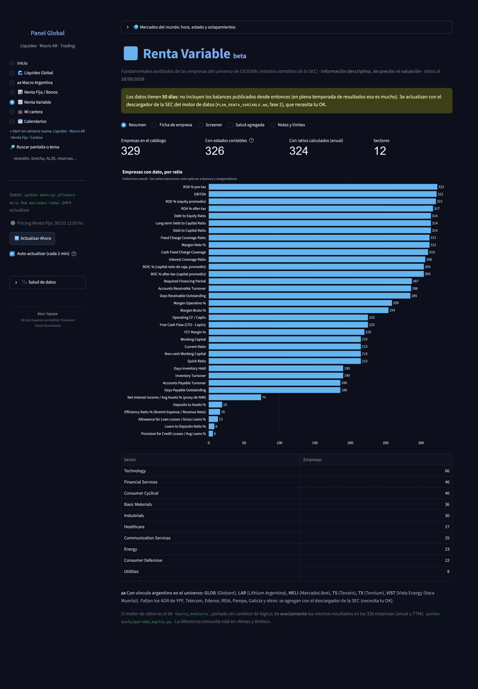
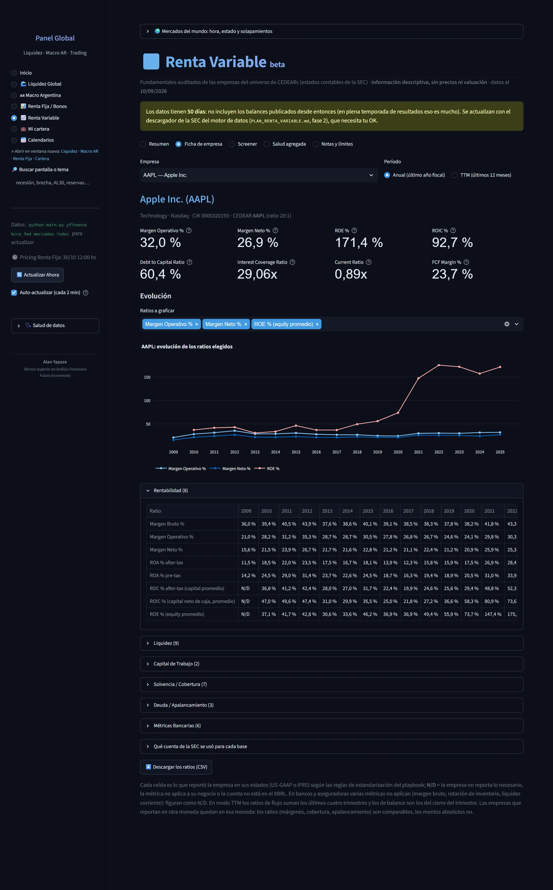
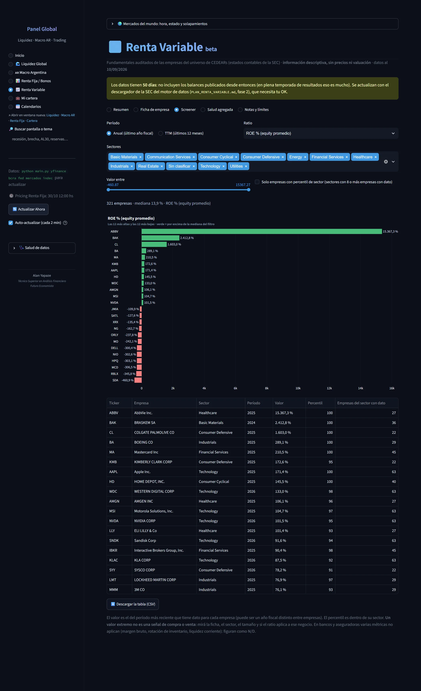
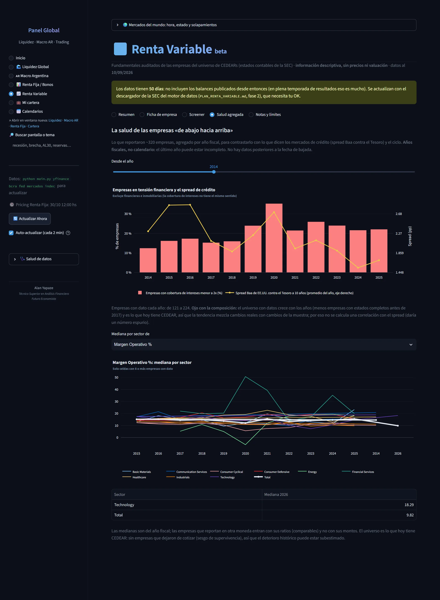
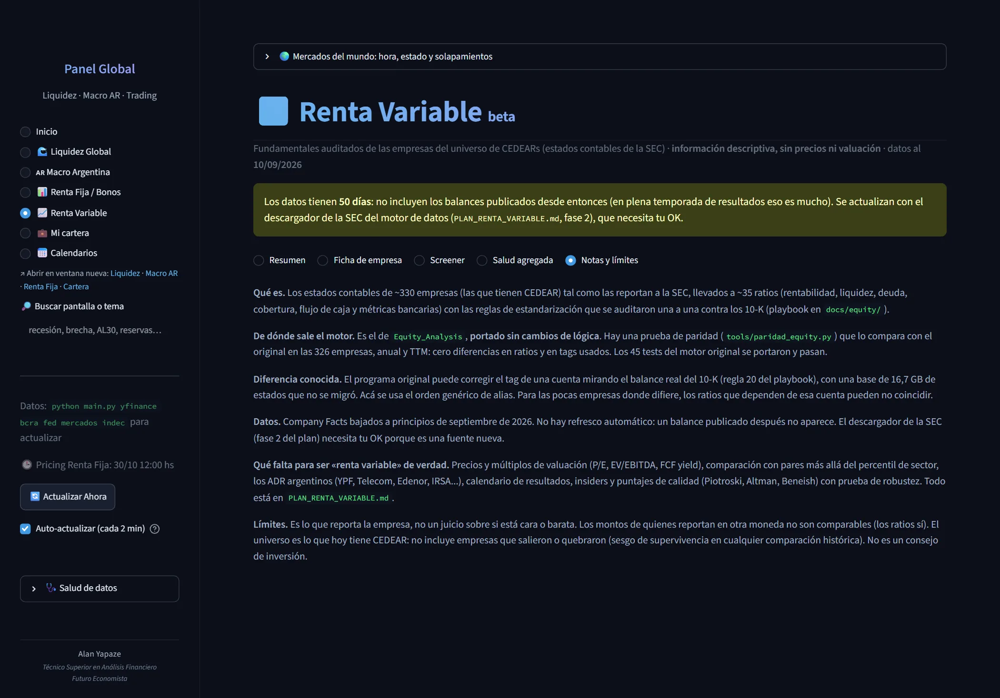

# 📈 Renta Variable

Análisis fundamental de empresas a partir de los estados contables presentados ante la SEC.

**5 pantallas.** [Volver al índice](README.md) · [Inicio del repositorio](../../README.md)

> ℹ️ **Sobre estas capturas:** muestran una herramienta de análisis con datos de mercado del día. Los tickers, rendimientos y señales que aparecen son resultados del cálculo para ilustrar su funcionamiento: **no son recomendaciones de inversión** ni ofertas de compra o venta.

## Resumen

> Fundamentales auditados de las empresas del universo de CEDEARs (estados contables presentados ante la SEC): resumen del universo. Información descriptiva, sin precios ni valuación; datos al 10/09/2026.

## Ficha de empresa

> Ficha de una empresa (ejemplo: Apple): sector, bolsa, CIK, CEDEAR con su ratio, y sus ratios anuales y de los últimos doce meses.

## Screener

> Screener: el valor de cada ratio es el del período más reciente de cada empresa y el percentil se mide dentro de su sector. Un valor extremo no es una señal de compra o venta: hay que mirar la ficha, el sector, el tamaño y si el ratio aplica a ese negocio.

## Salud agregada

> Lo que reportaron unas 320 empresas, agregado por año fiscal, para contrastarlo con los mercados de crédito (spread Baa contra el Tesoro) y el ciclo. Son años fiscales, no calendario: el último puede estar incompleto.

## Notas y límites

> Notas y límites: los datos son del 10/09/2026 y no incluyen los balances publicados desde entonces (en plena temporada de resultados eso es mucho).
